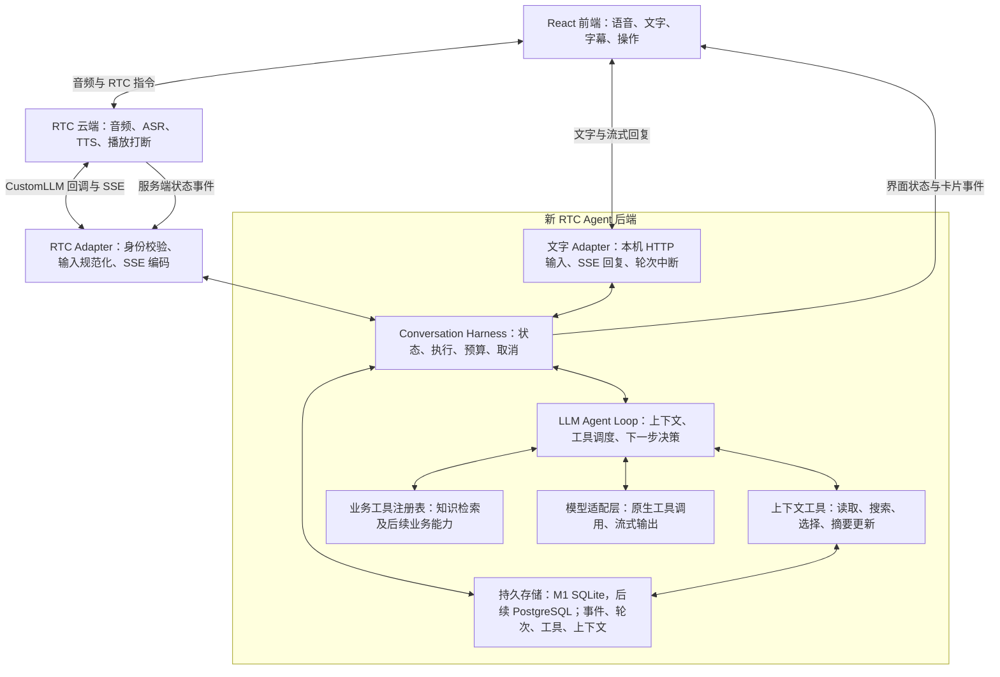
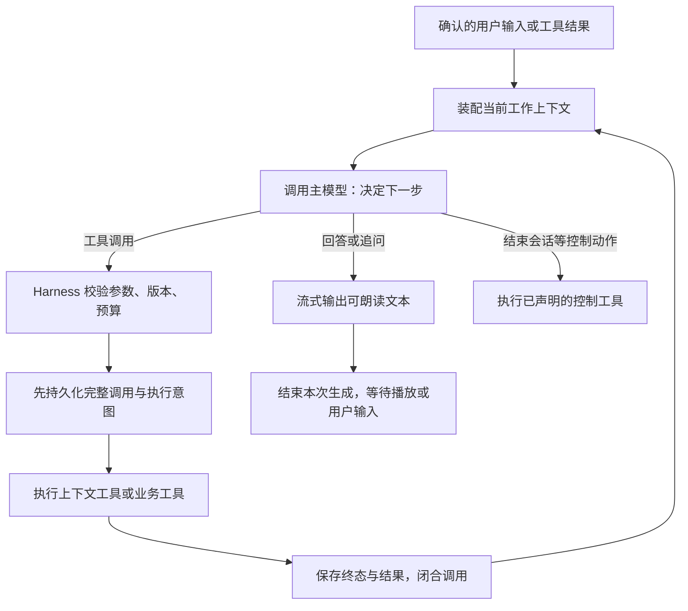

# RTC Agent 后端设计：Harness + LLM Agent Loop

> 版本：v0.19 · 状态：M4 正式 React、登录、文字及 RTC 已基础验收；用户授权后的本机旧服务退役已执行，生产发布仍独立，见第 23～24 节 · 更新日期：2026-11-17（Asia/Shanghai）
>
> 本文是新后端的设计基线。后续想法在文末继续补充，确认后同步修改正文与决策记录。
> `backend_harness_loop` 保留 M0 工具，并新增两层循环、可替换模型和知识库适配器、持久会话、文字与 RTC Adapter、压缩快照、分段候选及独立工作视图编辑。M0 历史结果见第 18 节，M1 见第 19 节，M2 见第 20 节，M3 见第 21～22 节。用户已决定不再补齐 M2 剩余性能验收；历史性能失败保持原状。M4 复用原 PostgreSQL 账号，正式 React 已基础跑通；本机旧业务服务现已退役，默认入口切换至独立新后端。完整性能/物理音频量化、生产发布及回滚演练仍与本轮分开。

## 1. 已确定的方向

1. 重新构建后端，以实时对话 Agent 为核心建立模块和数据模型。
2. 保留现有前端 RTC 接入能力，包括设备管理、加退房、音频发布订阅、文字指令和字幕展示。
3. **上下文的语义管理、工具选择与调度、Agent Loop 的下一步决策交给大模型。**
4. **Harness 提供执行环境**：事件接入、状态维护、工具执行、资源预算、取消、持久化和运行记录。
5. 先确定整体方案，后续在本文持续补充，再分阶段实施。
6. RTC 接入保留 `2024-12-01`，沿用现有实时音视频应用与自有 ASR/TTS 资源，先完成兼容验证；新后端重建不要求同时迁移供应商新版 API。

“已确定”来自当前需求；本文的目录结构、工具名称、预算数值和技术实现均为初版建议。供应商协议相关事项另列为待验证项。

## 2. 目标与范围

新系统需要支持连续交流、用户改口、按需检索、多步工具调用和随时打断。模型可以根据观察结果改变处理方式，用户无需把任务拆成一组独立问答。

第一版交付范围：语音与文字共用会话、模型自主调用上下文和知识检索工具、流式回复、完整取消链路、会话持久化及执行追踪。

后续扩展：课程卡片、图片和视频、业务写操作、后台长任务、跨会话记忆、多运行时实例。扩展能力通过同一运行时接入。

### 2.1 现有项目的复用边界

| 部分                                               | 新方案中的处理方式                                   |
| -------------------------------------------------- | ---------------------------------------------------- |
| `src/lib/RtcClient.ts`、设备管理和音频发布订阅     | 保留 RTC 能力，必要时补充通话标识与控制事件          |
| `TextComposer.tsx`、字幕、打断按钮                 | 保留交互，适配统一会话标识和消息状态                 |
| `src/utils/handler.ts`、`src/store/slices/room.ts` | 根据新事件协议调整；前端消费状态，不执行后端业务工具 |
| 当前前端登录流程、RTC 启停接口                     | 新后端提供明确的边界接口，减少前端改动               |
| `rag_llm_server/` 的业务编排                       | 后续由新后端替换，旧实现作为接口与供应商联调参考     |
| 现有账号与登录数据                                 | 单独制定迁移方式，代码替换不隐含删除数据             |
| 火山 RTC、ASR、TTS、方舟和知识库服务               | 作为可替换的外部适配器接入                           |

当前后端的 `main.py` 固定编排意图改写、RAG 和主模型调用；`llm_service.py` 只保留普通对话文本；`models.py` 主要存储账号信息。新后端从运行时职责重新设计，不沿用这些模块之间的编排关系。

## 3. 总体架构



模型适配层面向模型协议；RTC Adapter 面向火山协议。业务运行时使用内部事件，两种外部协议分别转换。

第一版建议采用 Python、FastAPI、异步模型客户端和 PostgreSQL，先构建模块化单体。第一版只有一个运行时 worker；多实例方案在会话归属和取消机制验证后开启。

## 4. 大模型与 Harness 的责任边界

| 事项       | 大模型负责                                             | Harness 负责                                         |
| ---------- | ------------------------------------------------------ | ---------------------------------------------------- |
| 对话理解   | 理解用户目标、指代、否定、修正和缺失信息               | 提供原始输入及可信的系统规则                         |
| 上下文管理 | 决定读取哪些历史、保留哪些工作信息、何时摘要和调整摘要 | 数据读取、引用校验、版本控制、Token 硬上限、物理装配 |
| 工具选择   | 决定是否调用、调用哪个工具及参数                       | 提供能力清单，校验名称、参数和访问范围               |
| 工具调度   | 决定顺序、依赖关系，以及是否请求并行                   | 验证依赖与冲突，执行并发限制、超时、幂等和取消       |
| Loop 决策  | 根据工具结果选择继续、换方法、追问、回答或等待         | 驱动循环，执行停止条件，阻止无限运行                 |
| 语音回复   | 决定回复内容及需要向用户提出的问题                     | 区分内部输出与可播报文本，编码和发送                 |
| 运行状态   | 提出业务动作和工作上下文变更                           | 维护会话、轮次、任务及播放状态的真实生命周期         |

业务语义不通过关键词路由表代替模型决定。问候、业务查询、媒体请求和检索改写都由模型在主 Loop 中理解；工具清单与系统规则说明当前真正具备的能力。

Harness 可以直接处理断连、权限失败、预算耗尽、无效参数和版本冲突。这些属于执行约束，不需要等待模型批准。达到硬限制时可使用预先审核的简短故障提示，属于基础设施降级。

## 5. 运行模型：会话控制循环与模型决策循环

### 5.1 会话控制循环

每个会话有一个有效的状态写入者。控制循环接收用户输入、打断、外部观察结果和连接状态；模型及工具调用作为可取消的异步子任务运行。

控制循环等待事件和子任务结果，不能在等待模型网络响应期间阻塞打断处理。最终状态修改通过同一会话控制器提交。

主要事件：

| 事件                                     | 含义                                         |
| ---------------------------------------- | -------------------------------------------- |
| `user.input.final`                       | 一次已经确认的语音或文字输入，允许启动轮次   |
| `user.interrupt`                         | 用户主动打断，立即使当前执行失效             |
| `model.output`                           | 模型动作或可见文本，不包含隐藏思维过程       |
| `tool.result`                            | 工具终态结果，包括失败和取消                 |
| `playback.started/completed/interrupted` | RTC 观测到的播放状态                         |
| `transport.disconnected`                 | 当前回调流或通话连接断开，按实际断开范围处理 |
| `session.closed`                         | 会话关闭，停止产生新的业务输出               |

字幕和状态事件更新展示或播放状态。它们与 CustomLLM 回调中属于同一用户输入的消息需要关联，不能重复启动推理。

### 5.2 模型决策循环



模型概念上的动作包括：读取历史、调整上下文、调用业务工具、回答、追问、等待用户，以及按能力配置结束会话。

第一版建议以模型原生工具调用表达上下文和业务动作，以最终文本表达回答或追问。普通轮次进入同一个主 Loop，需要信息时模型才请求工具。**不设置每轮必经的意图识别、RAG、Context Planner 或固定反思模型。**语音的决策 / 回复分支采用第 8.2 节的明确协议，相关模型调用计入同一预算。

一次内部模型调用结束，不代表整个用户轮次结束。`tool_calls` 结束原因驱动工具执行和下一次模型调用；最终文本生成结束后关闭本轮生成流。随后新用户输入启动新的轮次。

## 6. 上下文管理：模型维护工作视图，系统保存原始事实

### 6.1 借鉴 Claude Code 的公开机制

本次按 CC 指 Claude Code 理解。借鉴范围是其公开说明的工作方式，具体阈值、数据结构、历史查询工具和 RTC 调度策略由本项目定义。

- Claude Code 将持续规则与会话历史区分处理，接近上下文容量时压缩历史，保留摘要后继续工作。[CC：上下文窗口](https://code.claude.com/docs/en/context-window)
- CC 会保存会话记录，模型通过工具获取后续需要的信息；运行时为模型提供工具和上下文。[CC：工作原理](https://code.claude.com/docs/en/how-claude-code-works)
- 用户维护的规则与模型维护的笔记具有不同职责。[CC：规则与记忆](https://code.claude.com/docs/en/memory)
- Anthropic 提倡保留信息引用、按需读取，以及通过压缩和笔记维持长任务连续性。[上下文工程说明](https://www.anthropic.com/research/effective-context-engineering-for-ai-agents)

对应 RTC 的方案是：**固定规则 + 工作摘要和笔记 + 近期完整对话 + 可回查的历史索引**。模型在主 Loop 内决定信息取舍；Harness 检测容量并安排压缩机会，由模型生成压缩内容。普通轮次保持直接调用主模型。

### 6.2 分层存储与模型实际看到的输入

| 层             | 内容                                               | 更新与加载方式                               |
| -------------- | -------------------------------------------------- | -------------------------------------------- |
| 固定规则与能力 | 人设、业务证据要求、工具定义、上下文操作说明       | 服务端版本化配置；压缩后重新装配             |
| 原始会话账本   | 用户原文、实际输出、工具调用及结果、打断和播放事件 | Harness 追加保存；按范围和引用读取           |
| 工作视图       | 目标、约束、待确认项、摘要、选中的证据及历史目录   | 模型通过上下文工具维护，服务端保存版本       |
| 活动尾部       | 尚未被当前摘要覆盖的近期完整轮次及当前工具链       | Harness 按序装配，遵守协议闭合和容量限制     |
| 跨会话记忆     | 长期偏好等                                         | 后续设计，当前不自动把单次对话推广为长期事实 |

压缩只替换工作视图和活动窗口，不删除原始账本。原始记录仍服从未来的数据保存期限和删除要求；这里的“追加保存”不表示永久保存。

一次模型输入的逻辑结构：

```text
1. 固定系统规则、当前可用工具和上下文操作说明
2. 服务端运行状态：时间与时区、epoch、版本、容量、剩余步骤和时间
3. 工作摘要与模型笔记：带来源的目标、约束、事实、疑问和未完成动作
4. 历史地图：原始记录范围、摘要覆盖区间、可回查主题和结果引用
5. 选中的历史证据与全部未概括的完整尾部，按原始顺序去重装配
6. 当前用户输入、当前轮工具调用与结果等受保护的活动协议帧
```

第 2 ～ 4 项标明各自来源。历史、摘要和工具正文是带边界的数据，不提升为系统指令；外部文本中的“改写规则”等内容不改变运行时规则。

启动包先取最新有效快照，并从 `compacted_through_seq + 1` 按序装入全部尚未概括的完整轮次；取尾部的起点与快照创建时间无关。**先计算这些未概括历史的容量压力，再决定是否压缩，不能先截成最近几轮再计量。**

v0.14 将同一冻结上界的账本材料改为批量读取；一次同步决策预检内复用这一份材料，绑定实际工具后重新完整计量。跨模型或工具 I/O 后重新读取，提交继续校验版本、epoch、来源与材料指纹。该优化不缓存一个较短历史来替代全部未覆盖材料。没有可压缩闭合前缀时不提供 `context_compact`；存在前缀但可选工具定义本身会使请求超限时也不提供，避免模型反复调用不可能执行的压缩。其它工具及内容取舍仍由主模型决定。

“最近 4 轮、约 3000 Token”是压缩后原文尾部的初始保留目标，不是每次请求机械裁剪历史的上限。正常追加时，未经已提交摘要覆盖的尾部可以超过此目标，直到安排维护或接近安全预算；在此之前仍进入模型输入。若尾部无法安全装入，则先执行第 6.7 节维护路径，失败时明确降级并暴露缺口，不能静默跳过。

当前用户输入、其直接回答的上一条问题、当前工具链和未解决的运行状态属于锚点，不为凑轮数切断。大输入超过容量时明确返回限制或请求缩小输入，不静默截断。

启动包会告诉模型：`ledger_through_seq`、`compacted_through_seq`、`recent_from_seq`、`uncovered_ranges`、`context_version`、当前窗口未包含的主题引用，以及剩余容量。`uncovered_ranges` 指尚未被有效摘要覆盖且无法完整装入的区间，正常输入应为空；维护或故障状态必须显式携带实际缺口。主题目录由模型在摘要时更新，服务端补充真实的记录范围；目录可能不完整，缺少条目不能证明历史中没有相关内容。

### 6.3 模型怎样决定保留哪些信息

模型每次决策使用下列保留准则；不增加一个独立的打分模型，也不使用关键词权重决定业务相关性。

| 信息类别       | 模型优先保留什么                               | 推荐表示                                |
| -------------- | ---------------------------------------------- | --------------------------------------- |
| 当前目标       | 用户正在解决的问题、当前讨论对象和决定         | 简短目标 + 原文引用                     |
| 有效约束       | 预算、时间、否定条件、用户修正及适用范围       | 原值或原话片段 + 来源 + 有效状态        |
| 业务依据       | 当前回答需要的价格、日期、课程属性和查询状态   | 关键字段 + 业务来源引用；需要时回查正文 |
| 未完成事项     | 待回答问题、缺失参数、待确认动作、未知执行结果 | 明确待办及实际执行状态                  |
| 对话衔接       | 用户当前指代的对象、上一轮问题、被打断的回答   | 近期原文和生成 / 播放观察               |
| 已完成的旧话题 | 将来可能回查的结论及证据位置                   | 主题索引 + 一句结论 + 引用              |
| 重复与临时内容 | 重复检索正文、冗余表达、已消费的工具调试信息   | 移出工作窗口，保留可回查引用            |

每个保留项标记 `representation`：`verbatim`（保留原文）、`fact`（结构化要点）、`pointer`（仅保留引用）。历史内容可以移出工作窗口，但不能因此变成“用户从未说过”。

条目至少包含 `id`、`kind`、`value`、`source_type`、`source_refs`、`status`；发生替换时增加 `supersedes`。可选 `retain_for` 用一句短标签说明用途，例如“下轮课程筛选条件”，不要求输出思维过程。

来源区分：`user_statement`、`tool_evidence`、`assistant_claim`、`inference`。用户说“我以为课程是 3000 元”和课程接口报价不互相替代；模型把差异保留为待核实问题。模型自报置信度不能作为事实验证。

用户更新自己的偏好时，模型显式建立替换关系，例如将“只考虑周末”标为被“工作日晚上也行”修正。时间更新本身不赋予其他来源更高真实性；业务价格和日期仍需有效业务证据。

对金额、日期、否定词和执行状态，摘要保留原值与引用。相对日期同时保留用户原话及发言时区，标准化后的日期单独标注，避免随当前日期漂移。

### 6.4 工作快照的具体结构

以下为本项目数据草案，示例内容均为假设的会话数据：

```json
{
  "context_version": 8,
  "base_version": 7,
  "compacted_through_seq": 96,
  "summary": {
    "goals": [{ "id": "g1", "text": "选择适合零基础用户的课程", "source_refs": ["evt_12"] }],
    "items": [
      {
        "id": "c2",
        "kind": "constraint",
        "value": { "budget_max": 3000, "currency": "CNY" },
        "representation": "fact",
        "source_type": "user_statement",
        "source_refs": ["evt_95"],
        "status": "active",
        "supersedes": ["c1"],
        "retain_for": "课程筛选"
      }
    ],
    "open_questions": [{ "text": "用户的学习目标尚未明确", "source_refs": ["evt_96"] }],
    "pending_actions": [],
    "topic_index": [{ "topic": "曾比较的课程", "source_refs": ["turn_4", "result_7"] }]
  },
  "selected_refs": ["result_7"],
  "protected_refs": ["turn_18"],
  "archive_pointer": { "from_seq": 1, "through_seq": 96 }
}
```

`protected_refs` 和记录范围由 Harness 根据真实状态设置，模型不能任意取消。快照还要存储候选生成时的输入视图引用、Token 计量和提示词版本，便于排查摘要遗漏。

统一使用 `context_version` 表示工作视图版本，`compacted_through_seq` 表示已提交摘要覆盖的连续历史前缀上界。`context_update/select` 只能增加视图版本，不能推进覆盖水位。只有经过校验、无未处理孔洞的压缩才能推进水位。当前分段恢复只处理顺序连续的闭合前缀，另存候选链的 `segment_after_seq/covered_through_seq`；活动输入继续报告完整未覆盖范围。未来若允许不连续片段，再使用显式 `covered_ranges`，不能用最大已处理序号冒充完整覆盖。

历史单条证据以带角色、来源和引用的数据块装配，`selected_refs=["result_7"]` 不还原成孤立的原生 `role=tool` 消息。当前工具链按模型原生协议保留；确需恢复旧协议时，恢复完整闭合组。引用相同内容只计量和装配一次。

已完成且不再影响当前任务的动作可以转为主题指针。未确认的外部动作仍是未完成事项，不因摘要变短而变成成功。

### 6.5 历史如何搜索和读取

主模型在以下情况主动回查：当前指代对象不清；摘要缺少用户提到的旧条件；需要准确复述金额或日期；当前信息与摘要冲突；准备继续一个旧任务。

推荐流程为“先看近期原文和摘要 → 搜索定位 → 必要时读原文 → 判断能否回答”。模型已有明确引用时可以直接读取，不强制先搜索；信息充分时不调用上下文工具。

#### `context_search`：定位历史

```json
{
  "query": "之前比较的 Python 课程",
  "filters": { "kinds": ["user_input", "tool_result"], "before_seq": 120 },
  "match_mode": "terms",
  "limit": 5,
  "cursor": null
}
```

会话、用户、有效 epoch 和最大可见 `seq` 由 Harness 绑定，模型不能通过工具参数搜索其他用户的会话。第一版使用范围过滤和支持中文的子串 / 关键词匹配；模型可以改写查询或切换 `literal/terms`。向量搜索作为后续增强。

结果包含 `snapshot_seq`、`matches`、`source_refs`、原始角色、时间、短片段、`truncated`、`next_cursor`。默认最多 5 条、总结果约 1000 Token；命中更多时用游标继续读取。

同一组分页游标绑定查询和 `snapshot_seq`，新消息不改变已有分页范围。补查新事件使用新的查询快照。结构化事件可按 `turn_id`、工具名称、事件类型和时间范围过滤；这些字段来自原始账本。

#### `context_read`：读取原文或工具结果

```json
{
  "refs": ["evt_57", "result_7"],
  "include": "turn_neighborhood",
  "max_tokens": 2000,
  "cursor": null
}
```

返回原文、来源、引用、事件序号、关联轮次、执行状态和可用的播放观察；相邻问答帮助理解“它”“还是那个”等指代。长工具结果提供分页或段落引用，不能整份重复灌入上下文。

截断必须显式返回 `truncated=true`、有效范围及续读游标。金额、日期、否定和待执行动作的关键证据优先读原文，搜索短片段仅用于定位。

上下文工具统一使用第 7 章的结果信封：无命中为 `status=no_results`；历史暂不可读为 `status=error`、`error.code=history_unavailable`；分页完成和截断分别表示。读取失败不等于用户没说过，模型可以调整查询或向用户澄清。

### 6.6 模型怎样维护工作视图

| 工具              | 关键参数                                                                                                            | 提交效果                                           |
| ----------------- | ------------------------------------------------------------------------------------------------------------------- | -------------------------------------------------- |
| `context_update`  | `expected_context_version`、`upserts=[{section,id,kind,text/value/topic,source_type,source_refs,status,supersedes?}]`   | 按稳定 ID 更新五个摘要分区；保留未修改条目        |
| `context_select`  | `expected_context_version`、`keep_refs`、`release_refs`、`purpose`                                                 | 增加或释放后续窗口中显式加载的原始记录             |
| `context_compact` | `expected_context_version`、`covered_through_seq`、完整结构化 `summary`、`keep_refs`、`target_tokens`、可选 `focus` | 用模型摘要替换已闭合的旧窗口，保留锚点和未覆盖尾部 |

`release_refs` 仅移出工作视图；原始记录依然存在。模型只在新信息会影响后续步骤时调用更新，普通短对话无需每轮写笔记。

`context_compact` 可以一次提交保留清单和摘要，无需先调用 `context_select`。工具本身不隐藏新的模型请求。每次成功修改递增 `context_version`，结果返回新版本、实际覆盖范围和装配后 Token；失败保留旧版本。

模型输出的工具参数完整后才执行。只接受有来源的条目；来源不存在、跨会话、超出本次实际可见范围或来源角色不匹配时，返回明确错误。数字、否定与执行状态的语义仍由主模型判断。v0.16 的 M3 知识工具另外校验 `kb:` 来源身份，仍不能把来源校验称为任意业务语义证明。

当前结构化编辑的实际契约：

- `section` 为 `goals/items/open_questions/pending_actions/topic_index` 之一；单次最多 16 个 upsert，每分区最多 32 条，完整摘要最大 32768 UTF-8 字节。条目必须有稳定 `id`、`kind`、`source_type`、非空 `source_refs`、`status`，以及 `text/value/topic` 至少一个。`status` 为 `active/pending/resolved/superseded/uncertain`；可选 `representation`、`retain_for`。
- 同 ID 替换该条；新 ID 追加该条。`supersedes` 指向已有 ID，旧条目保留并标为 `superseded`，拒绝自指、循环或同批冲突状态。可以在同一 upsert 批中明确将旧条目标为 superseded 并新增替代项。旧压缩条目没有 ID 时，Harness 在资料中提供 `summary_entry_ids`，例如 `legacy:items:0`，按当前版本定位后才允许更新。
- `keep_refs` 是增量保留，不是完整替换；`release_refs` 仅取消显式保留。两者不重叠，每列表最多 64 个，最终最多 64 个。`purpose` 是最多 120 字符的资料标签。当前输入和近期保护原文不因 release 消失，已归档原文仍可回查。单条选中证据当前最多加载 3000 字符，截断时携带续读元数据；同一已加载原文去重，旧工具结果作为资料装配，不生成孤立原生帧。
- 本次模型可见来源包括正常加载的原文、摘要已含的来源、实际加载的选中证据、当前 `current_input_refs`，以及已持久化且与本次原生链匹配的成功历史工具结果。普通用户或助手正文中的 JSON/序号不能伪造工具读取凭据。`user_statement/tool_evidence/assistant_claim` 至少有对应 user/tool/assistant 来源，推断使用 `inference`。
- 执行前冻结版本、epoch、记录上界、当前用户引用、材料指纹和可见白名单；提交前以完整候选、当前工具参数及成功结果预留重新计量。超容量返回 `context_edit_over_budget`；旧版本返回 `context_version_conflict` 和当前版本/水位，失败不改变工作视图。

`context_edits` 追加保存每次编辑后的完整视图及输入凭据，与原生成功结果、事件和版本在同一事务提交。读取时按版本选择最新编辑或压缩快照；编辑不改变 `compacted_through_seq`，也不增加压缩次数。`context_update_notes` 继续单独维护兼容笔记和 `notes_version`，同样推进共享 `context_version`。任一工作视图写入都会使旧压缩计划和旧分段基线失效。重开存储可恢复编辑，取消或迟到写入仍受当前 owner 校验。

模型决策输入始终带当前版本、已选引用和当前用户引用；当前输入前另加可信边界说明，旧原文中的编辑指令不自动重放。最终回复遵守本轮指定格式，涉及变更只凭本轮成功工具结果确认。每个上下文动作继续计入原有步骤、工具和时间预算，不隐藏额外模型请求。同一决策批的写调用共享冻结版本，首个写入成功后，其余同版写入会冲突，应在下一次模型决策读取新状态后再提交。

普通决策协议可在 profile 指定 `decision_tool_choice=auto|required`，缺省 `auto` 保留第三方兼容性。当前 Pro / Flash 配置使用 `required`，保持原有 thinking disabled：模型必须选择一个有效工具动作，普通回答可选择 `prepare_response`，仍由主模型决定是否编辑、查询或回答。最终阶段仍为 `none`；自动压缩继续使用指定 `context_compact`。required 下供应商若只返回文本，Harness 以 `model_action_required` 明确失败，不将其直接转为成功回复。该设置不改变调用、工具、输出或时间预算。

DeepSeek 文档说明非思考模式支持 `required`，但它只约束必须提出工具动作，不指定调用哪个工具；思考模式不支持 required，需按 profile 能力配置。[官方 Chat Completions 参数](https://api-docs.deepseek.com/api/create-chat-completion/)；本项目两型号继续使用既定非思考配置，实际结果另见 20.7。

### 6.7 什么时候提示或自动压缩

容量按实际请求计算，包括系统规则、工具 Schema、所有消息、模型要求的协议字段和工具结果。优先使用对应模型的 Token 计量；无法精确计量时采用保守估计并保留余量。

```text
B_request = min(模型窗口 - 最终输出预留 - 计量安全余量, 配置输入上限)
B_dynamic = B_request - 固定规则与工具定义 - 当前输入和受保护协议帧
pressure  = 动态视图 Token / B_dynamic
```

动态视图包含工作摘要、选中历史、全部未被摘要覆盖的尾部和补读内容。用实际完整候选或其保守 Token 上界计量，不能通过丢弃未概括轮次来降低压力。若 `B_dynamic <= 0`，先处理超大固定输入或当前输入，不能依赖摘要解决。压缩模型调用另按其输出上限验证窗口，并在软阈值阶段预留生成候选及继续回复的空间。

例如配置输入上限为 16384 Token，扣除固定内容和锚点后剩 12288，动态视图为 9000 时压力约 73%。阈值基于可用动态预算，不能直接把整个模型窗口的 70% 当成历史容量。

| 条件                                    | Harness 行为                                                             | 大模型的决定                                                   |
| --------------------------------------- | ------------------------------------------------------------------------ | -------------------------------------------------------------- |
| `pressure < 0.70`                       | 正常进入主 Loop                                                          | 信息已足够时直接回答；需要时读取或更新                         |
| `0.70 <= pressure < 0.85`               | 注入容量提醒，在合适边界安排维护机会                                     | 选择移出冗余片段、压缩已闭合区间或保留当前视图                 |
| `pressure >= 0.85` 或下一结果预计装不下 | 在下一次正常模型调用前安排 `compact_only` 维护，或让有效 Loop 先提交压缩 | 模型决定摘要内容和保留项；维护调用只生成候选                   |
| 已超输入硬预算                          | 停止扩张；使用能装入的维护输入，无法安全装配则明确降级                   | 根据实际可见材料压缩；看不到的区间保留引用，不能宣称已完整概括 |
| 话题阶段完成、用户要求重点记住某事      | 提供更新 / 压缩能力，不机械触发全量摘要                                  | 模型选择做局部笔记、更新约束或带 `focus` 压缩                  |

存在未概括且无法装入的区间时，即使当前已装入窗口看似很小，也先安排缺口恢复 / 压缩。模型可以分段读取并生成有明确覆盖范围的摘要；材料不足时保留缺口，不能宣称已经概括。

当前实现按闭合轮次选择本次维护请求能容纳的连续前缀。若压缩后累计摘要加全部剩余原文仍超预算，将结果写入独立候选表，继续处理下一段；活动快照、版本、水位和完整历史压力不改变。候选只进入下一次维护输入，不能进入普通决策或最终回复。整段视图能安全装入后才原子激活。单个闭合轮次本身装不入维护请求时明确失败，不拆开原生协议，也不跳过该轮去处理后面的片段。

自动触发解决“什么时候安排一次压缩”，信息取舍和摘要文本仍由模型完成。所有数值是初始配置，属于本项目建议，不代表 CC 的内部阈值。

每次模型请求前、工具结果加入前，以及构建新视图后重新计量。大工具结果先保存为引用并按可用容量分页；清理冗余正文不会丢掉调用、执行状态和结果位置。

目标压力初始设为 `<= 0.50`，属于优化目标。提交硬条件是来源、版本、覆盖和协议正确，候选在输入硬预算内，并为下一步所需结果与最终回复留下空间。90% 降到 60% 等有实质收益的候选可提交并返回 `target_met=false`、实际压力和原因，不因未达 50% 拒绝所有改进。

针对相同业务输入上界与相同内容版本，不重复安排无新增材料的自动压缩；维护事件本身不能当作新增业务材料。失败最多修正一次并计入预算。无足够缩减或受保护内容已占满容量时，报告原因并缩小读取或明确降级，避免反复整理相同内容。

### 6.8 压缩的生成、校验和原子替换

1. 在模型调用边界冻结候选输入：基础版本、有效 epoch、记录上界 `S`、已经闭合的可压缩范围、受保护引用和目标容量。
2. 将原有摘要、待压缩原文与工作笔记交给主模型。模型输出 `context_compact` 参数，或在维护模式输出同结构的 `CompactProposal`。
3. 模型保留目标、最新约束、未解决问题、业务结果状态和原始来源；重复正文缩为引用。未改变的条目尽量原样保留 ID，发生变化时显式建立修正关系。
4. Harness 检查结构、来源、覆盖范围、受保护条目、原生工具协议闭合、预期版本及 epoch，并装配候选视图计算 Token。
5. 在短事务中条件提交新快照，同时记录 `context.compacted` 事件。快照和事件的提交保持一致，不让活动视图指向未落库候选。
6. 重新注入固定规则、当前运行状态与完整活动尾部。晚于 `S` 的事件不被摘要覆盖；`compacted_through_seq` 只推进到真实可替换的闭合边界。

分段候选额外记录父候选、基础版本、笔记版本、每段闭合起止边界、已处理前缀材料指纹及恢复配置指纹。每段都由同一会话主模型合并“上一累计摘要 + 下一连续段原文”。提交校验逐段验证父链和来源，不用序号最大值推断覆盖；上一段已处理但未在累计摘要中保留的原文，不自动成为下一模型的引用白名单。最终快照可引用经校验的候选链作为先前各段的覆盖凭据。

候选和其原生工具成功结果也在同一事务保存；失败不改变活动视图。每段必须相对上一候选加剩余历史产生实质缩减，不能靠很早的压缩收益掩盖后续摘要膨胀。前台每段计入本轮模型、工具和首输出期限，成功分段不会重置预算；预算结束而完整输入仍装不下时返回 `context_maintenance_pending` 并保留已完成候选，等待后续新输入续接。后台每次仍最多一个模型请求。

压缩中出现新用户输入或打断会使旧 epoch 失效；即使基础版本没变也拒绝旧候选。纯播放进度等事件可以继续追加到尾部，候选提交时保留这些新事件并按当前状态装配。

当前轮未闭合的工具调用不能摘要掉。若 `context_compact` 作为当前模型工具被调用，其调用与成功结果也加入活动尾部，下一次模型请求中保持合法配对；不会让摘要删掉自己的协议帧。

每次压缩继续携带原始账本引用。模型修改关键数字、否定或结论前回查原文；不能仅凭反复概括旧摘要生成一个失去来源的新事实。

结构校验只能验证引用、状态及格式等条件，不能证明语义没有遗漏。摘要保真依靠保留准则、关键原文锚点和第 6.12 节评测；不把“JSON 合法”当成压缩成功的全部标准。

### 6.9 如何兼顾 RTC 响应与调用成本

普通输入先使用当前视图调用主模型。模型可在同一步请求多个相互独立的上下文工具，第一版由 Harness 串行执行；只有结果真正影响下一步时才再调用模型。上下文管理不增加独立前置 Planner；第 8.2 节为语音协议增加的最终回复阶段仍计入模型调用数。

后台维护只在回复生成结束、上下文有压力且没有新输入时启动。`compact_only` 模式使用同一主模型、关闭业务工具，只生成结构化候选；成功提交后即结束维护，无需再生成一句用户回复。

后台维护有独立上限：初始每次最多 1 次模型请求、5 秒和 1500 输出 Token，按真实用量记录，不能以“后台”名义忽略费用。用户新输入优先取消维护；若候选还未提交，其内容全部留在待审记录，不影响活动视图。

前台确实需要压缩时，它消耗第 12 章的同一首输出期限、轮次时长和 `max_model_steps`。工具内部不会获得额外无限步骤。时间不足时保持旧快照并明确降级；不能保证所有长历史恢复都和短问答一样快。

| 场景                 | 模型调用路径                                | 调用次数                          |
| -------------------- | ------------------------------------------- | --------------------------------- |
| 短对话信息充分       | prepare_response → 最终流式回复             | 默认 2；单阶段需通过 M0           |
| 旧指代不清           | 搜索 → 读原文 → prepare_response → 最终回复 | 默认 4                            |
| 已有材料需要压缩     | 提交摘要 → prepare_response → 最终回复      | 默认 3                            |
| 搜索、读取后必须压缩 | 搜索 → 读取 → 压缩 → 最终回复               | 4；末次直接进入关闭工具的回复阶段 |
| 回复后的后台维护     | 单独生成 `CompactProposal`，无语音输出      | 额外 1 次，有独立维护限额         |

始终为最终回复保留一次模型调用及时间预算。达到第 4 次调用时直接进入关闭工具的回复阶段，不再创建新工具任务；用户语义仍由模型处理。可选更新留到后续边界；必须完成的原生消息闭合与实际执行状态记录由 Harness 执行，不增加隐藏的第 5 次模型调用。

### 6.10 失败、冲突与恢复

| 情况                            | 处理                                                                                       |
| ------------------------------- | ------------------------------------------------------------------------------------------ |
| 无效 JSON、引用不存在、越界覆盖 | 拒绝候选并返回具体错误；预算允许时模型修正一次                                             |
| `context_version` 冲突          | 返回 `status=error`、`error.code=context_version_conflict` 和最新版本信息；禁止盲目覆盖    |
| 新输入 / 打断导致 epoch 失效    | 取消旧维护，候选不提交；使用最新输入和已提交视图                                           |
| 候选未达到容量目标              | 硬条件不满足则拒绝；仅未达期望目标时按第 6.7 节接受有实质收益的候选，标记 target_met=false |
| 历史不可用或搜索不完整          | 明确记录缺口；模型可澄清，避免编造旧内容                                                   |
| 进程中断                        | 恢复最后活动快照与完整账本；重新验证已落库候选链，下一维护请求从其连续边界续接               |
| 新 epoch 复用已完成分段         | 重新冻结当前输入、保护边界与材料；基础/笔记/配置版本或前缀指纹变化则放弃复用，保留原候选审计 |

若已提交摘要被发现语义错误，模型读取原文后提交修正版；上一版保留作审计。禁止直接回滚到旧版本号并丢弃期间新输入。

### 6.11 系统提示中的上下文准则草案

```text
你负责当前会话的信息选择和工作记忆维护。
优先保留当前目标、有效约束、最新修正、待确认问题及未完成动作。
金额、日期、否定条件和执行状态保留原值与来源；推断单独标识。
先使用已提供的工作视图。信息足够时直接回答，不为整理而固定调用工具。
遇到旧指代、缺失细节或冲突时，使用 context_search / context_read 获取证据。
搜索无结果不代表用户没有说过；读取不完整时标记缺口，必要时追问。
容量有压力时，将重复正文改为引用；摘要保留关键原文和未完成事项。
通过 context_update / context_select / context_compact 提交变更。
遵守服务端提供的版本、覆盖范围和预算；被取消的轮次不能提交新视图。
只输出动作和必要的摘要内容，不输出隐藏分析过程，也不向用户朗读内部记录。
```

维护模式另带 `focus`、候选输入范围、保护引用和目标大小，要求仅输出 `CompactProposal`。固定业务规则由服务端重新装配，模型笔记不能覆盖它们。

### 6.12 完整场景与验收

| 场景                                | 模型看到什么、如何行动                   | 预期视图与验收                                                   |
| ----------------------------------- | ---------------------------------------- | ---------------------------------------------------------------- |
| 短对话“你好”                        | 当前输入和小型启动包；直接回复           | 默认 2 次模型调用，0 次上下文工具                                |
| 长对话达到 85%                      | 历史原文、基础快照、范围和容量；生成候选 | 新视图达到目标，原始历史仍可读取；低于回落线前不反复压缩         |
| 用户问“你刚才第二个说的那个”        | 摘要只有主题引用；搜索定位并读取相邻问答 | 搜索结果带 `snapshot_seq`，读回原文后确认对象；默认 4 次模型调用 |
| “预算从 5000 改为 3000，周末不要了” | 旧约束及当前原文锚点；更新 `supersedes`  | 只将旧偏好标为被修正，保留新金额和否定；原话有引用               |
| 候选生成中用户改口                  | 维护冻结在 epoch 9，新输入进入 epoch 10  | 旧候选提交失败，新条件仍在活动尾部，不被旧摘要覆盖               |
| 工具超时后做摘要                    | 可见实际工具结果 `unknown_outcome`       | 未完成事项继续保留未知状态，不能摘要成成功                       |
| 连续两次压缩后追问旧数字            | 新摘要带原始引用，按需读原记录           | 返回准确来源；不从摘要的概括中猜测数字                           |
| 历史长结果与分页                    | 搜索命中、截断标识、固定快照游标         | 能续读且不跨页漏项；新消息不改变旧查询范围                       |
| 超长导入历史超过输入硬预算          | 主模型逐段合并累计摘要和下一个闭合前缀   | 候选未完成时活动水位不动；完整剩余历史能装入后才激活               |
| 分段后取消 / 重开存储               | 新 owner 重新验证候选链并冻结当前材料    | 只复用已完成段；迟到结果、缺失父段、来源越界、版本变化均不能越过校验 |

离线回放记录关键约束保持率、无依据事实引入数、引用有效率、原文恢复准确率、压缩后 Token 和重复压缩次数。人工标注的关键数字、否定及未完成动作在首批回归样例中必须全部保留；该验收只代表样例通过，不承诺任意对话零遗漏。

另设近期尾部边界用例：对话超过 4 轮但尚未摘要时，全部未概括轮次仍参与压力计量和输入；早期预算与否定不因近期保留目标而消失。无法完整装入时暴露缺口并进入维护路径，不能只测当前已装入窗口。

在线基准另外测首音延迟、历史工具调用次数、压缩调用成本，以及新输入抢占维护后的取消耗时。语义检查与格式检查分别报告。

## 7. 工具调度：模型选任务，后端统一执行

### 7.1 工具契约

每个工具至少声明：`name`、`description`、`input_schema`、`output_schema`、`effect_type`、`timeout_ms`、`max_result_tokens`、`parallel_safe`、`cancellation_mode`。

第一版先提供上下文工具与 `knowledge_search`。课程查询、媒体查询、人工接入、报名等能力在业务接口存在后扩展。

运行时同时注册第 8.2 节的 `prepare_response` 控制工具。它与上下文工具都消耗调用及结果容量，但不计为业务检索次数。

模型决定查询内容、调用顺序和是否需要再次检索。Harness 根据真实能力清单限制执行范围，未注册能力不能被执行。

v0.16 已接入只读 `knowledge_search(query, limit?)`，仅在知识库配置有效时提供给主模型。工具清单、执行与结果容量使用同一 Loop，不恢复旧后端的每轮前置检索。`KnowledgeBackend` 将归一化片段与供应商 HTTP 协议分开；当前内置 `viking_knowledge`，接口地址、资源和密钥引用独立配置，详见第 21 节。

结果结构示意：

```json
{
  "tool_call_id": "call_001",
  "status": "success",
  "data": {
    "hits": [
      {
        "text": "示例课程资料",
        "source_id": "doc_001",
        "reference": "ref_001"
      }
    ]
  },
  "error": null,
  "truncated": false
}
```

终态包括 `success`、`no_results`、`timeout`、`error`、`cancelled` 和 `unknown_outcome`。最后一种用于外部动作是否提交尚不能确认的情况。模型根据这些观察结果选择后续动作。

### 7.2 顺序与并行

默认先支持顺序执行。需要并行时，由模型在同一步声明调用批次与依赖，Harness 只执行没有未满足依赖和资源冲突的部分。

只读、相互独立的检索可以进入并行批次；修改同一份工作上下文的操作需要串行或明确的版本合并。存在前置结果依赖的动作等待后续模型步骤提供真实参数。

工具结果按调用 ID 关联，按协议顺序回填，不能用完成先后顺序替代调用关系。超时或失败也要保存对应终态结果。

### 7.3 写操作、重试与取消

业务写工具声明资源范围、业务确认条件和幂等键。Harness 检查动作是否满足执行条件，模型不能绕过这些约束。

同一个逻辑写动作在网络重试、恢复和重复回调中复用业务幂等键。该键独立于模型可能重新生成的 `tool_call_id`；参数相同但属于用户新请求的动作也不能简单合并。

只读请求可按预算进行有限重试。写操作超时优先查证外部状态，确认结果前使用 `unknown_outcome`，避免直接重做。取消协程不会自动撤销已提交的外部动作。

### 7.4 工具执行的提交顺序

1. 接纳输入时先落库轮次；收到完整工具动作后，先保存原生 assistant 调用、`action_id`、参数、幂等键及 `prepared` 执行意图，再分发外部调用。校验或持久化失败时不执行动作。
2. 分发记录进入 `dispatched`。模型重复返回同一调用时读取已有执行，不重复分发；新模型调用 ID 与同一业务动作的幂等关系由 `action_id` 维护。
3. 内部上下文变更、对应工具成功结果及版本事件在同一短事务提交。外部服务与本地数据库无法跨系统原子提交，结果未知必须保留并查证。
4. 保存每个调用的终态，按原协议闭合消息；未知动作后续核实为成功或失败时追加结果核实事件，不向旧工具链重复插入结果，也不改成“当时已经确认成功”。

恢复时，`prepared` 且可证明未分发的动作可重新评估；`dispatched` 而未记录结果的动作先查证。第一版只读工具允许有界重试，业务写工具仍按第 7.3 节处理，不能统一自动重做。

## 8. 模型协议与实时输出

### 8.1 模型适配层

适配层完整保存模型原生消息，包括工具调用 ID、名称、参数和结果。流式工具参数按调用位置及 ID 合并，参数完整、结构校验通过后才执行。

控制决策、上下文操作和工具 JSON 留在后端。RTC 输出仅包含允许向用户播报的文本；记录动作和证据即可，无需收集或展示模型隐藏思维过程。

若选用的接口需要回传特定协议字段，适配层按该接口要求保留；工作上下文压缩不能破坏活动工具链。[方舟工具调用文档](https://docs.volcengine.com/docs/ark/function-calling?lang=en)

### 8.2 工具分支与语音分支

原生流中的首个文本片段不能证明后面不会出现工具调用。已经播出的内容无法撤回，不能仅凭提示词或“目前没有 tool_calls”就确定语音分支。

默认使用保守的两阶段模式：

1. **决策 / 工具阶段**：主模型可以调用上下文和业务工具，文本只作为内部草稿，不发送 TTS。模型需要回复时调用控制工具 `prepare_response`，参数为 `mode=answer/clarify`、可用证据引用及可选回复重点；该工具只切换阶段，没有业务副作用。
2. **最终回复阶段**：同一主模型基于实际输入与工具结果流式生成回答，关闭所有新工具调用。阶段一草稿不当作已经说过的内容，也不直接替代用户原始问题。

模型在决策阶段直接输出普通文本时，按未播报草稿处理，仍在剩余预算内进入最终回复阶段。到达最后允许的模型调用时，由预算约束直接进入最终回复阶段，省去 `prepare_response`；这只是能力限制，具体回答或澄清内容由模型决定。

普通对话在此模式下通常需要两次模型调用。该成本与首音延迟计入第 12 章，不能宣称一次调用与可靠分支隔离同时得到保证。

只有 M0 证明所选模型接口具备可靠的早期分支承诺机制时，才通过显式配置启用单阶段优化。回归需覆盖文本后跟工具、参数分片、长度截断和错误。最终阶段出现工具调用或内部控制数据属于协议错误，停止该流且不执行动作。

v0.15 实测遇到模型将内部 DSML 调用标记放进最终 `content` 的情况。适配器对这些保留标记做有界分片暂存，完整标记跨多个 delta 时也在进入 TTS 前拒绝；不将标记解析成工具调用，不执行补调，不额外重试。普通文本与字面尖括号仍保留。最终提示明确只服从本轮请求的格式，历史中的旧格式不延续到当前答案。拒绝结果作为失败记录，不能拿 Harness 提示充当模型首输出。

### 8.3 RTC SSE 与内部事件

RTC Adapter 统一生成一条外部回复流。多个内部模型步骤共享一个稳定的外部流 ID，逐步发送符合厂商格式的文本片段；正常可写连接最终发送结束片段和 `data: [DONE]`。连接已断开时直接清理资源，不再尝试写结束符。

内部模型流结束符不能提前结束外部用户轮次。Token 用量按内部调用累计，不能只记录最后一次调用。

内部建议使用 `speech.delta`、`ui.card`、`tool.started`、`tool.completed`、`turn.generation_completed`、`turn.cancelled`、`runtime.error` 等事件。界面事件经独立的后端 SSE 通道传给前端，HTTP 接口接收控制操作。

模型或工具失败后，将明确错误作为观察结果交给有效 Loop；已输出部分语音时，不自动从头重播整段回答。尚未输出且预算允许时，模型可选择修正或降级。

每次 HTTP 回调另有 `attempt_id/connection_id`，同一轮次只有一个有效输出连接。断连处理仅在连接仍拥有该执行时取消它，旧连接退出不能取消新执行。供应商有稳定请求标识时，重复尝试默认返回明确的冲突 / 已终止状态，不重新生成或从头重放；实际 HTTP 状态与厂商重试行为必须在 M0 验证。没有稳定标识时不能仅凭文本认定重试，也不能承诺精确去重。

### 8.4 界面事件重连与展示归属

界面事件带 `event_id`、本地 `seq`、`rtc_run_id`、`turn_id`、`epoch`。新增授权的会话状态快照接口，返回快照及其水位线；订阅从该水位线之后回放并继续接收，避免先查状态再订阅造成漏事件。

事件流接受游标或 `Last-Event-ID`。游标超过保留范围时要求重新取得快照；迟到的旧轮次事件只更新对应历史，不覆盖当前状态。界面重连仅恢复状态与已显示内容，不驱动 TTS 重播。

第一版字幕正文继续由 RTC 字幕通道提供；后端事件提供执行状态及后续卡片，同一回复不再追加一份后端文本消息。前端本地文字乐观消息与回调结果按标识校准，不按文本合并两个不同输入。

## 9. 会话、轮次和状态

### 9.1 标识

| 标识                           | 用途                                |
| ------------------------------ | ----------------------------------- |
| `user_id` / `login_session_id` | 账号与登录身份                      |
| `conversation_id`              | 业务会话，可包含多次 RTC 连接       |
| `rtc_run_id` / `rtc_task_id`   | 一次实际 RTC 通话与供应商任务映射   |
| `turn_id`                      | 一次确认的用户输入及对应 Agent 执行 |
| `step_id` / `model_request_id` | 一次决策步骤与模型请求              |
| `tool_call_id` / `action_id`   | 模型工具调用与可持久化业务动作      |
| `event_id` / `seq`             | 去重标识和本地有序事件序号          |
| `epoch` / `context_version`    | 当前执行有效性和工作上下文版本      |

登录身份、业务会话与通话任务分别建模。后端创建并校验映射；客户端提供的会话标识需要结合登录身份验证。

### 9.2 三种状态分别记录

- 会话状态：`active`、`closed`。
- 轮次执行状态：`running`、`waiting_tool`、`responding`、`generation_completed`、`cancelled`、`failed`。
- 播放状态：`not_started`、`playing`、`completed`、`interrupted`、`unknown`。

每个确认的新用户输入通过会话控制器使旧执行失效，分配新的 `turn_id` 与单调递增的 `epoch`；重复请求不会分配新 epoch。一个会话同一时刻至多有一个可发出业务输出的轮次。

生成完成、发送完成、播放完成分别记录。字幕完成标志不等于用户已经听完；厂商回调通常只能提供播放阶段的观察，不能证明用户实际听到了每个字。

工作上下文包含上一轮是否被中断、已发送内容及播放观察。无法确认的部分标为未知，模型据此组织后续回答。

### 9.3 RTC 运行资源状态

`rtc_runs` 单独记录 `reserved → starting → active → stopping → stopped`，以及 `unknown/failed/expired` 和 `desired_state=running/stopped`。创建时预先保存供应商任务 ID、预留到期时间、授权归属及回调凭据状态。

Start 超时可能已经成功，先置为 `unknown`，保留同一任务 ID；禁止立即换任务 ID 再启动。用户退出后将期望状态置为 `stopped`，即使启动结果未知也进入清理流程。Stop 失败持续对账，不以浏览器离开或 `audioBotEnabled=false` 证明云端已停止。

按所选供应商版本能力执行查询或幂等停止补偿，限制重试并记录最后错误；无法确认则保持未知并产生运维告警，不能伪记停止成功。预留 TTL、启动失败、退出、授权撤销、服务重启与进程关闭均有回收入口。

该清理属于实时资源生命周期，第一版即实现；第 12 章暂缓的是业务后台长任务，不包含资源对账。

第一版一个业务会话最多有一个有效 RTC 运行，多标签页默认创建各自会话。恢复既有会话时先使旧运行失效，再绑定新运行；旧 Stop 只回收旧运行，不能关闭新运行或删除业务会话。所有运行状态转换检查当前版本与期望状态，迟到的 Start 成功不能把已经要求停止的运行重新激活。

## 10. 打断、并发与恢复

### 10.1 打断处理

1. 前端 RTC 指令或云端机制停止当前播放，记录目标轮次。
2. 后端验证 `control_event_id + rtc_run_id + target_turn_id + expected_epoch` 与当前执行匹配，且该控制尚未处理，再增加 `epoch`，标记目标执行失效。
3. 请求取消模型流及可取消工具，关闭上游网络连接，设置清理期限。
4. 所有输出和工作上下文提交检查 `turn_id + epoch`；旧执行不再发送语音或修改当前工作视图。
5. 收到新输入后启动新轮次；只有打断而没有新输入时保持等待，不自动继续旧回答。

前端手动打断应同时通知 RTC 和后端；云端自动打断通过服务端状态回调进入 Harness。SSE 断连是额外取消信号，不作为唯一信号。

旧轮次的迟到打断、重复控制和播放结束事件只记入其目标历史，不能取消或重置新轮次。云端事件须经经过联调的任务 / 轮次映射定位；目标不明确时不得默认作用于“当前最新轮次”。前端未取得目标标识时仍可停止本地播放，但后端取消确认与云端停止能力分别标记，不能伪报整条链路已经取消。

迟到的工具结果可以进入原执行的审计记录；已提交业务动作继续查证真实结果。是否把该结果用于新轮次，由当前有效模型决定。

### 10.2 事件去重与顺序

供应商事件和应用请求使用各自的稳定标识去重，再生成本地 `seq`。终态不因迟到的旧阶段事件倒退；外部时间戳辅助排查，不作为唯一顺序依据。

**不能按问题文本或文本 Hash 判断重复输入。** 用户连续两次说同一句话可能是两个有效轮次。回调重试缺少稳定请求标识时，不能宣称精确去重，需先解决供应商契约或接入层的关联能力。

### 10.3 多 worker 与进程恢复

第一版明确单运行时 worker。进程内锁和取消句柄只对当前进程有效，不能直接扩展为多个独立 worker。

后续多实例需要：会话归属路由、租约、所有权版本栅栏、跨实例控制事件和短事务条件提交。旧拥有者即使仍在运行，也无法提交新状态或继续输出。数据库锁不能跨模型网络等待长期持有。

重启后读取会话、工具结果与工作上下文；中断的模型流标记为未正常完成。默认不自动重放已播回复、不盲目重做外部动作；用户下一次输入可基于恢复的记录继续交流。

### 10.4 授权撤销与通话生命周期

`rtc_runs` 绑定创建它的 `login_session_id` 和账号。回调接纳、工具分发和界面订阅检查运行状态与授权；网页 Access JWT 的正常轮换不结束通话，登录会话撤销、绝对到期或账号禁用则结束其授权。

退出登录撤销该登录会话的运行，账号禁用撤销该账号所有运行：持久化撤销状态、使相关 epoch 失效、取消生成、关闭订阅，并请求停止云端任务。短期回调凭据不能绕过撤销；清理任务继续执行，不删除历史业务会话。

## 11. 前端与 RTC 接入协议

### 11.1 前端接口（v0.18 实际接入）

| 接口 | 当前用途 |
| --- | --- |
| `/api/auth/login`、`me`、`refresh`、`logout` | 复用现有 Cookie、刷新轮换与 CSRF 契约 |
| `GET /api/agent/models` | 登录后仅返回型号选项和 RTC 可用状态，不返回供应商配置或 Key |
| `POST /getScenes` | 兼容 React 场景列表形状；只提供型号元数据，不在加载页面时签发进房凭证 |
| `POST /api/agent/text/sessions` | 为当前账号和登录会话创建独立文字会话，固定 profile |
| `POST /api/agent/text/sessions/{id}/turns` | 接收 `round_id + text`；SSE 为 `turn/delta/terminal`，只显示最终答复 |
| `GET /api/agent/{text|rtc}/sessions/{id}` | 检查归属后返回本会话状态元数据 |
| `POST /api/agent/{text|rtc}/sessions/{id}/{action}` | 文字 `interrupt/heartbeat/stop`；RTC `start/heartbeat/stop`，均限定本次会话 |
| `POST /api/agent/rtc/sessions` | 真正 AppKey 与回调资源齐备时，签发独立房间/用户的短期 RTC 凭证 |
| `POST /api/chat_callback`、`POST /api/rtc/events` | 供应商回调凭据＋服务端 run/owner 映射，不要求浏览器 Cookie |

正式入口为 `product`；`/m0`、`/m1/text`、开发 nonce 管理接口和通用 `/proxy` 不安装在该应用。保留的 `serve/text/client` 仍是独立开发入口。原 `/api/conversations/*`、卡片事件流、快照水位重连与独立调试产品接口仍属后续设计，不能据草案声称已实现。

React 在实际加入语音时才创建 RTC 会话，保存其明确 `session_id`，复用 SDK 的设备管理、加退房、音频、字幕和 RTC `ExternalTextToLLM`。Start/Stop 针对该 ID；停止后重新开始需要新会话，不复活旧 epoch。失败清理不依赖 `audioBotEnabled`。RTC 内的文字输入只走 SDK，不同时发送 HTTP 文字请求。

独立 `/chat` 是正式 React 文字页，使用同一个 Agent Loop，但持有自己的文字会话；它不会接管或合并另一条 RTC 会话的账本。支持流式回复、停止本轮、新对话、离页清理及心跳。终态沿用运行时 `generation_completed`，不会把“生成完成”写成用户已经听完。

### 11.2 服务身份与回调关联

每次 RTC 运行绑定 `conversation_id`、用户、任务及有效期。CustomLLM 回调携带运行级能力凭据，由服务端校验并解析归属；优先使用所选版本支持的请求头方式，必要时使用受保护的 URL 参数，日志隐藏凭据。

已选旧版接入显式设置 `LLMConfig.EnableRoundId=true`。本轮实际回调带整数 `round_id`，可与状态 `RoundID` 和字幕 `data[].roundId` 对应。M1 以 `(rtc_run_id, provider_round_id)` 建立唯一轮次映射，并将原生轮次值保存为协议字段，不凭文本识别新轮次。首次接纳输入与映射在同一事务提交；同轮次重复尝试使用已有状态，不重新生成或从头播报；同一标识下输入内容冲突则作为协议错误处理。[旧版字段说明](https://docs.volcengine.com/docs/real-time-communication/start-voice-chat-ai-conversation-archived?lang=zh)

厂商支持通过 URL 业务参数、`Custom` 或额外请求头传递接入信息；具体支持范围按选定接口版本验证。[第三方模型接入文档](https://docs.volcengine.com/docs/real-time-communication/integrate-third-party-llm-or-agent?lang=zh)

AI 状态服务端回调需要单独配置接收地址及认证；状态中可带任务与轮次信息。它与 CustomLLM 的请求体不同，不能假定 `RoundID` 自动出现在模型请求中。[AI 状态文档](https://docs.volcengine.com/docs/real-time-communication/get-ai-status?lang=zh)

**会话内容以本地已提交账本为权威。**正常 CustomLLM 回调只把契约已确认的本次用户输入接纳一次，供应商 `messages` 中的历史用于关联和诊断，不重复导入、不反向覆盖本地回答、工具及中断状态。当前用户消息的字段 / 位置按已验证协议提取；不通过整段历史的文本差异猜测新输入。

第一版不自动从厂商历史重建旧会话；恢复从本地账本进行。若开启 RTC 固定欢迎语，记录为独立的 `transport_greeting`，发送与播放状态仍分别观测，不伪造用户轮次或模型输出，也不同时启动另一条欢迎播报。前端“已连接 / 可输入”依据通话状态，不以是否收到第一条字幕作为唯一依据。

### 11.3 开始编码前的契约联调门槛

- 选定 RTC API 版本、Web SDK 版本和主模型接口，保存脱敏请求样例。
- 核实确认输入、预填请求、重试请求如何区分，以及能否稳定关联任务、轮次、请求和播放事件。
- 核实用户打断、只停止播放、主动退出与 SSE 断连分别产生什么事件，以及各通道到达顺序。
- 验证状态回调认证方式；该认证与网页 Cookie、CustomLLM 凭据分别实现。
- 第一版关闭 Prefill；将来启用时，预取只用于可取消的只读计算，最终输入确认后才提交语音与业务写操作。
- 若无法稳定关联轮次，先限制为受控的单活动轮次只读场景并明确能力缺口；正式启用写操作之前必须解决身份、幂等和取消关联。
- 只读联调也不能承诺已解决误取消和回调重试。缺少稳定关联时，M0 记录为阻塞完整 RTC 验收的缺口；在关联方案验证前不启用自动重试接续和业务写动作。

## 12. 时间与资源预算

时间预算约束执行，不代替模型选择业务动作。运行时向模型提供剩余预算，模型在边界内选择工具和回复方式。

厂商当前文档给出 CustomLLM 请求的 10 秒响应超时要求。实现时需要验证其首包、有效文本及空闲超时的具体语义；不能用提前返回 HTTP 响应头或空心跳代替有效响应。[第三方模型接入文档](https://docs.volcengine.com/docs/real-time-communication/integrate-third-party-llm-or-agent?lang=zh)

以下是初始调试值，不是性能承诺：

| 配置                                | 初始建议                         | 用途                                         |
| ----------------------------------- | -------------------------------- | -------------------------------------------- |
| `first_output_deadline_ms`          | 6000                             | 在供应商边界之前产出有效回复或明确降级       |
| `turn_wall_time_limit_ms`           | 30000                            | 限制模型和工具累计执行，清理单独设期限       |
| `max_model_steps`                   | 4                                | 包含上下文操作、工具决策和最终回复           |
| `max_business_tool_calls`           | 3                                | 限制单轮业务工具数量                         |
| `tool_timeout_ms`                   | 工具单独声明；检索先以 1500 调试 | 同时服从当前轮次的剩余时间                   |
| `max_parallel_tools`                | 第一版 1，验证后扩展             | 控制资源消耗                                 |
| `context_soft_limit_ratio`          | 0.70                             | 基于第 6.7 节动态预算提示上下文压力          |
| `context_auto_compact_ratio`        | 0.85                             | 在模型调用边界安排模型压缩                   |
| `context_compact_target_ratio`      | 0.50                             | 压缩后的目标压力，避免频繁重复压缩           |
| `context_maintenance_max_calls`     | 1                                | 每次空闲维护最多一次模型请求，单独计费和记录 |
| `context_maintenance_timeout_ms`    | 5000                             | 空闲维护上限，新输入优先抢占                 |
| `context_maintenance_output_tokens` | 1500                             | 单次空闲摘要输出上限，容量目标同时校验       |

预算互相约束；各工具不能分别耗尽完整的首输出预算。历史搜索、读取、笔记更新和前台压缩全部计入同一轮次的模型步骤与时间；后台维护使用单独限额，并可被用户新输入抢占。相同参数反复调用且没有新增观察时，提示模型停止重复，超过次数由 Harness 终止。

基准分别测量：后端首个有效文本、用户停止说话到首音、工具耗时、打断后的音频停止和后端取消耗时，至少记录 P50 与 P95。

后台长任务暂不进入第一版。后续需要持久化任务 ID、结果获取、状态通知与过期规则，决定如何在当前话题中继续播报。

### 12.1 最终回复预留与全局背压

`max_model_steps=4` 包括决策、前台压缩、`prepare_response` 和最终回复。每次启动工具步骤前预留最终调用与可用时间；最后一次模型调用关闭工具。模型重试及格式修正也计数，不能因切换适配器或阶段重置次数和期限。

单步工具批次另设 `max_total_tool_calls=8`（包括上下文和控制工具，属于初始调试值），并限制合计结果容量；只限制业务检索次数不足以阻止一次模型调用产生大量上下文操作。所有计时使用单调时钟，首输出、空闲和总时长分别计量。

第一版部署必须配置全局 / 每用户活跃运行数、模型和工具并发、会话邮箱长度与输出缓冲上限。拒绝或限流发生在资源分配前；控制事件优先于普通输入，同一目标控制去重合并。输入过载不能覆盖已经接纳的输入并假装已处理。

语音输出与界面订阅各用有界队列。慢界面订阅断开后通过快照恢复，不阻塞语音；语音消费超时则取消对应连接及执行并记录交付不确定性。已请求取消但尚未结束的上游任务仍占用额度，避免无限创建残留请求。具体容量、空闲超时和取消清理期限列为 P-011 的压测参数，M4 前必须选定，不能保留为无限值。

## 13. 数据、部署与代码组织

### 13.1 数据模型草案

| 表或实体              | 主要内容                                                             |
| --------------------- | -------------------------------------------------------------------- |
| `conversations`       | 用户归属、生命周期、当前工作上下文版本                               |
| `rtc_runs`            | 房间、参与者、供应商任务、运行状态及有效期                           |
| `turns`               | 输入来源、执行 epoch、状态、输出摘要、结束原因                       |
| `conversation_events` | 有序事件、外部去重标识、来源和关联 ID                                |
| `model_steps`         | 输入视图引用、模型与提示词版本、可见动作、耗时和用量                 |
| `tool_calls`          | 参数、关联动作、执行状态、结果引用与业务幂等键                       |
| `context_snapshots`   | 带来源的工作条目、修正关系、摘要、历史目录、保留引用、覆盖范围和版本 |
| `context_edits`       | 独立摘要/证据编辑后的完整视图、版本、冻结材料凭据，不推进压缩覆盖     |
| `context_candidates`  | 尚未激活的分段累计摘要及连续父链凭据，与活动视图分离                 |

较长工具结果按引用读取，限制每次进入模型的大小。用户原文、工具输出和模型可见动作保留必要记录；逐 Token 输出可聚合为片段，避免把每个 Token 写成数据库事务。

持久化记录支持诊断、恢复和模拟回放；回放默认使用已记录的工具结果，不重新执行真实业务动作。模型版本变化或重新采样可能改变输出，不承诺逐字复现。

### 13.2 持久化与交付边界

用户输入及工具执行意图的关键持久化失败时，不继续开启业务执行；已经开始 SSE 时按协议终止并报告内部错误。数据库不可用不等于检索无结果或模型成功完成。

可播报输出按有序小片段记录 `generated/prepared` 后交给当前连接，写出后记录 `sent`；按片段批量提交，避免逐 Token 数据库事务。进程崩溃可能发生在写出与回记之间，此时交付状态记为 `unknown`。本地数据库无法与远端播放原子提交，设计不保证端到端恰好一次；恢复时默认不重放不确定的语音。

`conversation_events` 的提交记录是状态续传依据。事件与对应状态变更一起提交，界面发布读取已提交事件；发布通知丢失时仍能按 `seq` 补读，不能把进程内一次通知当作唯一事实。

### 13.3 目标代码结构

`backend_harness_loop/` 已有 M0 工具与 M1 首个运行时切片。M1 实际文件为 `app.py`、`runtime.py`、`models.py`、`store.py`、`tools.py`、`rtc_contract.py` 及模型配置、测试；`client.py` / `capture.py` / `web/` 同时支持 M0 固定回复与 M1 真实模型模式。下列目录树仍为后续目标结构，并非每个目标路径都已创建，当前映射见第 19 节。旧 `rag_llm_server/` 在正式切换、必要数据处理完成后退役。

```text
rtc_basic/
├─ src/                         # 现有 React RTC 前端
├─ docs/
│  └─ rtc-agent-backend-design.md
└─ backend_harness_loop/        # 已有M0/M1切片，下面为后续目标结构
   ├─ app.py
   ├─ config.py
   ├─ api/                      # 登录、会话、RTC 接入、调试
   ├─ runtime/
   │  ├─ harness.py             # 会话控制器与异步任务生命周期
   │  ├─ agent_loop.py          # 模型动作驱动循环
   │  ├─ events.py
   │  ├─ state.py
   │  └─ budgets.py
   ├─ context/                  # 工作视图、模型操作及容量管理
   ├─ tools/                    # 注册、参数契约、执行及知识检索
   ├─ adapters/
   │  ├─ rtc/                   # 火山 HTTP、TLV、SSE 和回调
   │  └─ models/                # 方舟等模型接口
   ├─ repositories/             # 事件、轮次、工具与快照存储
   ├─ prompts/                  # 角色、上下文工具、输出规则
   ├─ migrations/
   └─ tests/
```

`api → runtime → context/tools` 通过明确接口协作，外部服务经 adapters 接入，状态通过 repositories 提交。新增工具不修改通用循环中的业务分支。

## 14. 实施顺序与验收

### 14.1 里程碑

| 阶段                 | 交付物                                                | 完成标准                                   |
| -------------------- | ----------------------------------------------------- | ------------------------------------------ |
| M0：协议与模型验证   | RTC 请求样例、身份关联方案、原生工具及混合输出验证    | 轮次关联、取消和输出边界有可复现结论       |
| M1：最小新后端       | 新服务骨架、登录和 RTC 接入、统一事件、主模型流式回复 | 现有前端可进入房间，语音与文字共用新会话   |
| M2：Harness 与上下文 | 持久化、epoch 取消、工作视图、上下文工具              | 模型按需回查和摘要；打断后旧结果失效       |
| M3：业务工具 Loop    | 知识检索、完整工具消息、模型自主调度和停止            | 能完成多步只读咨询，错误可观察、循环有边界 |
| M4：切换与退役       | 基准、回归、账号数据处理和部署切换                    | 新后端独立运行，旧后端完成退役             |

以上是新系统的构建顺序，不要求两套后端长期共存。模型与工具适配器可在 M0 用隔离原型验证，产品接入统一使用新运行时。2026-11-17 完成正式前端/登录/文字/RTC 基础验真，随后依用户授权完成本机旧业务服务退役；生产对外发布与完整回滚演练另行处理。

### 14.2 关键验收场景

- 普通交流无需强制前置分类或检索；模型可不调用上下文或业务工具，直接选择进入最终回复阶段。
- 用户“它多少钱”时，模型能通过当前工作信息或历史工具补全对象，依据业务证据回答。
- 用户修正课程、时间或预算后，摘要仍保留最新修正、否定和原始数字。
- 上下文按第 6.12 节的场景验收；历史搜索可分页，原文可回查，压缩提交具有版本与 epoch 校验。
- 模型能决定不检索、继续检索、改写查询或先追问；工具调用由后端执行。
- 工具参数分片、错误 JSON、无结果、超时和失败均有可闭合的执行记录。
- 生成期间、工具等待期间、没有新输入时的打断均能停止有效输出。
- 旧结果迟到时不能污染当前工作上下文；已发生外部动作能查到真实状态。
- 同一事件重复到达不会重复执行动作；相同文本的新输入仍作为新轮次处理。
- 工具和控制 JSON 不进入 TTS；多步模型调用不会让 RTC 流提前结束。
- 重启后能查看轮次和工具终态，不自动重放已经发送的回复。
- 多用户会话与上下文隔离，前端不能越权操作其他会话。
- 首字、首音及取消延迟有基准，混合输出的保守策略成本被记录。

### 14.3 本轮审核结果与新增验收

v0.3 的本轮审核针对文档和现有前端；下列为当时补充的设计约束。v0.4 已实施其中的 M0 探针，实际结果见第 18 节，不能据此认为 M1 运行时已实现。

| 编号  | 优先级 | 发现的问题                                     | 已补充的处理                                                   |
| ----- | ------ | ---------------------------------------------- | -------------------------------------------------------------- |
| R-001 | P1     | 旧打断和旧连接关闭可能取消新轮次               | 第 8.3 / 10.1 节：目标元组校验、输出连接归属、重复控制幂等     |
| R-002 | P1     | SceneID 无法区分预留；启停超时会遗留云端资源   | 第 9.3 / 11.1 节：显式运行 ID、启停状态机、期望状态与回收      |
| R-003 | P1     | 云端消息历史与本地记录可能重复或冲突           | 第 11.2 节：本地账本为权威，当前输入单独接纳，欢迎语单独记录   |
| R-004 | P1     | 工具耗尽调用次数，或未确认分支就开始播报       | 第 6.9 / 8.2 / 12.1 节：保留最终回复，默认两阶段并核算额外调用 |
| R-005 | P1     | 动作执行后崩溃，无法判断是否可重做             | 第 7.4 / 13.2 节：先落执行意图，内部原子提交，外部未知结果查证 |
| R-006 | P2     | 快照版本与覆盖水位混淆；旧工具片段可能非法装配 | 第 6.2 / 6.4 节：版本与连续覆盖分离，历史证据使用数据封装      |
| R-007 | P2     | 未达 50% 就拒绝改进，导致重复压缩              | 第 6.7 / 6.10 节：优化目标与提交硬条件分离                     |
| R-008 | P1     | 登录撤销后运行级凭据可能继续执行               | 第 10.4 节：授权绑定、撤销失效及云端资源清理                   |
| R-009 | P2     | 界面断线丢终态，恢复后显示旧状态               | 第 8.4 / 11.1 节：快照水位线和事件续传，语音不重播             |
| R-010 | P2     | 单轮预算无法控制全局堆积，交付状态可能被误判   | 第 12.1 / 13.2 节：并发与队列上限、背压、交付未知状态          |

新增验收必须覆盖：旧打断晚于新输入到达、两个标签页交叉启停、Start 成功但响应丢失、注销后继续回调、动作执行前后进程崩溃、界面快照与订阅间产生新事件、慢消费者、90% 压到 60%、更新笔记后恢复未概括历史、第四次模型调用仍想调用工具，以及决策文本后出现工具调用。

实施入口是 M0 协议原型。**稳定轮次关联、默认输出模式与延迟、云端未知任务回收**是必须得到实测结论的门槛；源码和格式检查通过不等于这些条件已经通过。

## 15. 待验证与后续想法

本节用于继续补充。每条记录标注“待讨论 / 待验证 / 已采纳 / 暂缓”；采纳后同时修改对应正文，在下一节记录决策，保持正文代表当前方案。

| 编号  | 事项                                                    | 当前状态 | 下一步                                                                   |
| ----- | ------------------------------------------------------- | -------- | ------------------------------------------------------------------------ |
| P-001 | 主模型和原生工具接口选择，是否支持可靠的工具 / 回复分支 | 待验证   | 用真实流式样例测混合输出与延迟                                           |
| P-002 | RTC 版本及跨通道轮次关联                                | 部分通过 | 2024 服务端 2/2、真实客户端 1/1 轮次对应；极端重试仍待补，见 18.4 / 18.5 |
| P-003 | 第 6 章工作摘要、CC 式压缩流程、启动包和容量阈值        | 待验证   | 具体方案已补充，使用长对话、修正、分页及打断样例评测                     |
| P-004 | 第一批业务工具、可用知识来源及课程数据结构              | 待讨论   | 明确实际服务和返回契约                                                   |
| P-005 | 账号数据迁移、登录会话及新服务配置                      | 待讨论   | 实施前形成迁移与切换方案                                                 |
| P-006 | 图片、视频、课程卡片和后台任务                          | 暂缓     | 基础语音 Loop 完成后补充                                                 |
| P-007 | 跨会话记忆的保存、更新、删除与用户控制                  | 暂缓     | 单会话上下文验证后设计                                                   |
| P-008 | 模型决定并行调度的协议及多 worker 会话归属              | 暂缓     | 顺序执行基准完成后扩展                                                   |
| P-009 | 两阶段语音与首音预算、单阶段优化条件                    | 部分通过 | 两阶段文本已测、试音获用户确认；首音与停音量化基准仍待补，单阶段关闭     |
| P-010 | 云端启停未知结果、运行清理与授权撤销                    | 待验证   | 旧版 5 任务启停清理通过；未知状态与撤销极端场景继续验证                  |
| P-011 | 单 worker 总容量、背压及持久化输出延迟                  | 待验证   | 选定有限容量、清理期限并完成故障注入和压测                               |
| P-012 | 新版应用类型不匹配后的接入路线                          | 已采纳   | 用户选择 2024 旧版；服务端兼容实测通过，新版错误保留为历史记录           |

### 新想法追加模板

```text
编号：P-013
日期：YYYY-MM-DD
状态：待讨论
想法：
希望解决的问题：
影响的正文章节：
需要验证的内容：
最终结论：
```

## 16. 决策与修订记录

| 编号  | 日期       | 类型       | 内容                                                                                                              |
| ----- | ---------- | ---------- | ----------------------------------------------------------------------------------------------------------------- |
| D-001 | 2026-11-08 | 已确定需求 | 后端重新构建，保留前端 RTC 接入能力                                                                               |
| D-002 | 2026-11-08 | 已确定需求 | 上下文语义管理、工具调度和 Loop 决策由大模型负责                                                                  |
| D-003 | 2026-11-08 | 初版建议   | Harness 负责执行约束；上下文与业务能力以工具进入主 Loop                                                           |
| D-004 | 2026-11-08 | 初版建议   | 第一版单 Agent、单运行时 worker、顺序只读工具；后续扩展并行和业务动作                                             |
| D-005 | 2026-11-08 | 本轮范围   | 输出 v0.1 方案；现有代码、数据和云端配置保持当前状态                                                              |
| D-006 | 2026-11-08 | 需求细化   | 细化保留信息、压缩时机和历史读取，借鉴 CC（按 Claude Code 理解）的公开机制                                        |
| D-007 | 2026-11-08 | 初版建议   | 工作视图带来源与版本；容量触发由 Harness 处理，信息取舍和摘要由模型完成，按需读取原始账本                         |
| D-008 | 2026-11-08 | 已确定需求 | 新后端代码目录命名为 backend_harness_loop                                                                         |
| D-009 | 2026-11-08 | 审核补充   | 加入目标打断、运行身份和回收、账本权威、执行提交顺序、最终回复预留及上下文一致性约束                              |
| D-010 | 2026-11-08 | 初版建议   | 语音默认使用两阶段输出；单阶段优化须经模型协议和延迟验证                                                          |
| D-011 | 2026-11-08 | 实施范围   | 先实现 backend_harness_loop 的 M0 探针，按真实证据更新方案，不将离线验证当云端通过                                |
| D-012 | 2026-11-08 | 实测发现   | 模型显式禁用思考后原生工具与两阶段样本通过；RTC 2025 API 的应用类型不匹配，M0 总体未通过                          |
| D-013 | 2026-11-08 | 已确定需求 | 保留 2024-12-01 RTC 接口，先做兼容性验证，不要求迁移新版应用                                                      |
| D-014 | 2026-11-08 | 实测发现   | EnableRoundId 可关联模型/状态/字幕；移除 Method/ApiType 后样本无错误，503 及流取消观察记录见 18.4                 |
| D-015 | 2026-11-08 | 实施与实测 | 新目录提供独立 M0 客户端；显式临时 Token 绑定给定房间 / 用户，使用唯一 M0 任务；真实文字音频与人工试音结果见 18.5 |
| D-016 | 2026-11-08 | 测量边界   | SDK 语音终点、首非静音与持续停音均明确标为估计；每个样本先登记尝试，按实际回调轮次关联，失败和未完成样本不隐藏    |
| D-017 | 2026-11-08 | 已确定需求 | 两层循环、每会话一个主模型；支持 DeepSeek Pro / Flash，可替换 provider，接口地址、型号与密钥环境变量分离          |
| D-018 | 2026-11-08 | 实施范围   | M1 先交付 Loop 与 RTC 回调切片，采用单 worker SQLite 和最小上下文工具；产品登录与完整压缩仍未完成                 |
| D-019 | 2026-11-08 | 实测发现   | Pro 首次 6 秒首输出预算失败，9 秒复测通过；M1 默认 9 秒，M0 仍 6 秒，保留原失败且不作生产 SLO 承诺                |
| D-020 | 2026-11-08 | 验证边界   | M1 启动命令被自动审核拒绝，本轮改为真实模型+本地 ASGI 验证，云端 RTC 通话未标记通过                               |
| D-021 | 2026-11-08 | 后续实测   | 分别以前台命令启动隧道和服务成功；真实 Flash 语音与打断获用户功能确认，Pro 补充文字回传；不混用不同 run 的证据      |
| D-022 | 2026-11-08 | 实施修正   | 分开保存生成终态与播放打断；重启保留 RTC 启停观察，元数据按用户标识和轮次关联，聊天确认与页面确认分别记录             |
| D-023 | 2026-11-08 | 已确定需求与实施 | 增加独立文字输入 Adapter 和自由输入页，共用同一 Agent Loop；文字模式无需 RTC，即可自动验证上下文、回复与取消       |
| D-024 | 2026-11-09 | M2 实施 | 接入完整未覆盖尾部、结构化摘要快照、模型原生压缩工具、容量触发和同主模型后台维护；原文保留，提交受版本/epoch/来源约束 |
| D-025 | 2026-11-09 | M2 分段恢复 | 独立暂存累计候选并逐段校验连续父链；完整候选能装入后才激活，跨 epoch 重新冻结且拒绝迟到结果；20 秒功能通过，9 秒超长专项失败 |
| D-026 | 2026-11-09 | M2 结构化编辑 | 新增 context_update/context_select 和追加式 context_edits；共享版本但不推进覆盖，来源/原生链/容量受校验，当前输入与旧资料明确分界 |
| D-027 | 2026-11-10 | M2 性能优化 | 批量读取完整材料、同步预检复用、按 profile 复用 HTTP 连接；仅提供可执行且装得下的压缩工具，默认 9 秒/后台 5 秒均不放宽；结果见 20.8 |
| D-028 | 2026-11-16 | M2 RTC 收尾 | 压缩后真实 RTC 回调、ASR、回复和打断获功能确认；拒绝最终流的内部控制标记，补字段级安全诊断；当前文字样例通过，历史失败与量化缺口保留 |
| D-029 | 2026-11-16 | M2 用户验收 | 用户明确不再补齐 M2 剩余性能验收并进入 M3；M2 按该范围验收，历史失败、量化缺口和原报告继续保留，不宣称性能全通过 |
| D-030 | 2026-11-16 | M3 只读工具 | 主模型按需选 `knowledge_search`，原生工具记录闭合；来源索引与成功结果同事务提交，跨会话/取消来源不可用于确认；时间、调用及结果容量均有界 |
| D-031 | 2026-11-16 | 知识库可替换 | 用户要求方便后续换知识库；JSON 分离 adapter、HTTPS 地址、资源与密钥变量名，稳定 Backend/Hit 契约隔离协议差异；本轮按用户最终决定关闭服务端改写和重排 |
| D-032 | 2026-11-16 | 不报价引导 | 用户明确价格随优惠浮动，不应输出价格；改为确认课程和报名意向，无真实入口时如实待确认。完整报价正例由新业务目标替换，历史失败不转为通过 |
| D-033 | 2026-11-16 | 最终阶段边界 | 最终回复使用独立规则，移除过期决策预算；Pro/Flash 显式空工具清单＋none，保留原生记录和流式保护，无额外模型重试或预算增加 |
| D-034 | 2026-11-16 | M3 基础收尾 | 用户要求简单测、跑通后准备 M4；以文字和真实 RTC 云端业务主路径作为功能验收，保留额外回调缺失、9 秒超时及此前协议失败，深度测试后续进行 |

| 版本 | 日期       | 修订说明                                                                                                                       |
| ---- | ---------- | ------------------------------------------------------------------------------------------------------------------------------ |
| v0.1 | 2026-11-08 | 建立整体架构、模型与 Harness 边界、上下文工具、调度、状态、取消及后续补充区                                                    |
| v0.2 | 2026-11-08 | 细化第 6 章：CC 参考边界、保留准则、快照结构、历史工具、压缩触发、事务替换、RTC 预算与验收；同步预算和决策记录                 |
| v0.3 | 2026-11-08 | 审核补齐运行身份、迟到控制、启停补偿、原生消息与上下文水位、执行持久化、两阶段语音、最终回复预算、撤销和背压；新增审核验收表   |
| v0.4 | 2026-11-08 | 实现并执行 M0 本地和真实云端探针，记录模型思考模式、两阶段延迟、新版 RTC 应用阻塞及复现步骤                                    |
| v0.5 | 2026-11-08 | 新增 2024 配置与 AST 提取、旧版真实启停/轮次/503/流打断验证，记录 67 项测试与剩余客户端音频门槛                                |
| v0.6 | 2026-11-08 | 增加临时客户端、Token 两种模式、租约和崩溃恢复；101 项测试通过；真实文字音频链路、474ms SDK 停音估计和用户试音确认见 18.5      |
| v0.7 | 2026-11-08 | 增加测量状态机、尝试留痕与等待旧轮次结束；116 项 Python / 15 项 Node 测试通过，补充真实开麦和用户功能验收，见 18.6 / 18.7      |
| v0.8 | 2026-11-08 | 实现 M1 两层循环、模型与密钥分离、持久上下文工具和 RTC 回调；213 项 Python/16 项 Node 通过，真实模型本地验证及云端阻塞见 19 节 |
| v0.9 | 2026-11-08 | 恢复启动并完成真实 RTC 语音、回复、打断功能联调；补生成/播放状态分离、恢复记录及可重复脱敏汇总，详见 19.6 ～ 19.7       |
| v0.10 | 2026-11-08 | 增加无需 RTC 的文字服务、自由输入与流式回复页；通过真实 HTTP 与模型验证上下文和取消，详见 19.8                                   |
| v0.11 | 2026-11-09 | M2 接入模型驱动压缩、完整历史计压、原子快照与抢占式后台维护，新增文字压缩自测；实现与验真见第 20 节                              |
| v0.12 | 2026-11-09 | 实现超长历史分段候选、持久恢复与跨轮续接；48 轮导入历史的 Pro / Flash 文字功能通过，保留探针首次失败与默认 9 秒超时证据，见 20.6 |
| v0.13 | 2026-11-09 | 补齐独立摘要条目编辑和证据选择/释放；增加版本化视图事务、当前请求边界、文字自测和脱敏报告，见 20.7；保留全部失败批次 |
| v0.14 | 2026-11-10 | 增加默认预算文字长会话、后台维护与本地存储性能探针；优化材料读取和连接复用，保留失败与各批验证口径，见 20.8 |
| v0.15 | 2026-11-16 | 完成 M2 功能收尾及压缩后 RTC 功能验证；新增流式协议保护、候选校验诊断和隔离 RTC 探针，403 项 Python / 34 项 Node 通过；完整性能门槛见 20.9 |
| v0.16 | 2026-11-16 | 记录 M2 用户验收并进入 M3；接入可替换只读知识工具、独立配置、来源索引、剩余预算观察和真实文字探针；439 项 Python / 34 项 Node 通过，失败与实际验真范围见第 21 节 |
| v0.17 | 2026-11-16 | M3 改为不报价引导，补独立业务规则与最终阶段边界，451 项 Python / 34 项 Node 通过；完成基础文字和真实 RTC 云端业务跑通，准备 M4，失败及采样边界见第 22 节 |

## 17. 参考资料与事实边界

- 早期方案基于源码静态审阅；v0.4 增加真实模型、RTC OpenAPI 和公网健康探测，v0.5 / v0.6 补充轮次关联与真实客户端，详见第 18 节。用户停止说话到人耳首音的量化基准、生产延迟分位数及知识库性能仍未取得。
- [火山：接入第三方大模型或 Agent](https://docs.volcengine.com/docs/real-time-communication/integrate-third-party-llm-or-agent?lang=zh)：用于核对 CustomLLM、接入信息与响应约束；不同 API 版本需实测。
- [火山：获取 AI 状态](https://docs.volcengine.com/docs/real-time-communication/get-ai-status?lang=zh)：用于核对服务端状态接收和供应商轮次字段。
- [方舟：Function Calling](https://docs.volcengine.com/docs/ark/function-calling?lang=en)：用于核对模型原生工具调用协议；实际支持能力由选定模型验证。
- [Viking 知识库：search_knowledge](https://docs.volcengine.com/docs/vector-database-vikingdb/search-knowledge-new?lang=en)：用于核对 Bearer API Key、资源、检索结果及改写/重排参数；本轮复用现有 HTTP 协议，不导入旧后端。
- [Claude Code：上下文窗口](https://code.claude.com/docs/en/context-window)、[工作原理](https://code.claude.com/docs/en/how-claude-code-works)、[规则与记忆](https://code.claude.com/docs/en/memory)、[Anthropic：上下文工程](https://www.anthropic.com/research/effective-context-engineering-for-ai-agents)：本轮核对公开机制；第 6 章的工具 Schema、预算、数据模型和 RTC 处理是本项目设计。
- 本文中的模块边界、状态模型、工具名称、阶段划分和预算是本项目的设计建议，后续按验证结果修订。

## 18. M0 实施与验证结果（2026-11-08）

第 18.1 ～ 18.3 节保留 v0.4 首轮新版探测记录；当前接入路线已由用户确定为旧版 `2024-12-01`，服务端兼容结果见第 18.4 节，最新客户端结果与剩余门槛见第 18.5 节。新版应用类型不匹配不再是当前接入路线的阻塞原因。

### 18.1 交付范围与验收结论

已实现可重复运行的配置检查、离线协议验证、模型实测、RTC OpenAPI 实测及公网回调元数据采集器。代码位于 `backend_harness_loop/`，不导入旧后端模块、不复制密钥、不连接账号数据库。调用旧 `.env` 只用于显式读取已经存在的凭据。

**M0 已执行，但整体未通过，不进入 M1 正式业务实现。**模型和离线协议部分通过；RTC 新版启动被应用类型不匹配阻塞，真实轮次关联、回调重试和客户端音频打断没有验证。公网健康检查通过不能代替 RTC 回调证据。

机器证据：[`2026-11-08-m0.json`](../backend_harness_loop/validation_results/2026-11-08-m0.json)。复现说明：[`backend_harness_loop/README.md`](../backend_harness_loop/README.md)。临时日志、隧道地址和采集文件放在忽略的 `.local/`，公开结果只保留脱敏指标和错误码。

| 验证项                            | 结果          | 实际证据与边界                                                                               |
| --------------------------------- | ------------- | -------------------------------------------------------------------------------------------- |
| 新目录独立安装与单元验证          | 通过          | `uv sync --project backend_harness_loop` 建立独立虚拟环境并锁定依赖；45 项测试在新环境通过   |
| SSE / RTS TLV、迟到控制与连接归属 | 离线通过      | UTF-8 逐字节分片、协议结束、TLV 长度、旧 epoch、同轮旧连接、取消幂等等合成夹具通过           |
| 原生模型工具调用及结果回填        | 真实接口通过  | 关闭思考后成功；工具参数实际出现 10 个片段，重组与回填后读取验证结果正常                     |
| 两阶段回复                        | 本批样本通过  | 3 组均调用 `prepare_response`，最终阶段未携带工具定义，决策草稿不进入可播报输出              |
| 后端首有效文本预算                | 本批样本通过  | 3/3 小样本在 6000ms 内，样本 P50 约 1971ms、经验 P95 约 2103ms；不含 ASR、TTS 和客户端播放   |
| 单阶段优化                        | 关闭 / 未验证 | 本批无混合输出不足以证明早期分支承诺，维持默认两阶段                                         |
| 临时公网路由                      | 通过          | HTTPS `/healthz` 的 service 与 instance_id 匹配本次本地采集服务                              |
| RTC 未启动任务重复 Stop           | 真实接口通过  | 两次均 HTTP 200、无业务 Error；仅证明本次不存在任务的停止行为，不证明真实运行已被停止        |
| RTC `2025-06-01` Start            | 失败 / 阻塞   | HTTP 200 内部返回 `NoPermissionForApp`；代码正确识别为失败                                   |
| 本次 Start 后的清理               | API 请求成功  | finally 中同一独立 `m0_*` 任务执行两次 Stop 均成功；未操作旧任务                             |
| 真实轮次、回调重试与音频打断      | 阻塞          | Start 被拒绝，未发送文本驱动指令；云端 CustomLLM / RTS 采集记录为 0，也未运行真实 RTC 客户端 |

45 项测试覆盖配置隔离、报告脱敏、模型错误 / 超时、工具分片、工具结果闭合、RTS 认证、启停未知结果清理及可选的重复文本指令夹具。离线结果不替代云端结果；该批样本也不代表生产 P95。

### 18.2 实测发现与已做调整

**模型思考模式冲突。**最初指定工具调用返回 HTTP 400；有界复现的机器错误为 `invalid_request_error`，说明为 `Thinking mode does not support this tool_choice`。探针加入显式 `model_thinking=omit/enabled/disabled`；当前实时验证配置采用 `disabled`，随后 8 次请求通过，合计厂商报告 2137 Token。首次失败与成功结果分别保留，未静默重试或更换模型。

**代理环境影响回调检查。**环境代理下原地址检查出现 `RemoteProtocolError`，直连确认原隧道不可用。验证命令默认 `trust_env=false`，显式 `--trust-env` 才使用环境代理；随后使用临时隧道验证了本次采集实例的公网可达性。该结论只针对本机此次网络环境。

**API 版本与应用类型不匹配。**当前凭据调用新版 Start 得到 `NoPermissionForApp`。官方错误说明指出：`2025-06-01` 使用 AI 音视频互动方案应用；`2024-12-01` 使用实时音视频应用，两者不能只替换请求版本后混用。[官方错误说明](https://docs.volcengine.com/docs/real_time_communication/CallingtheStartVoiceChatinterfacereportsanerrorNoPermissionForApp?lang=zh)

若继续新版，需要配置该方案的 AppId，并在客户端使用同一新版应用的 AppKey 签发 Token；服务开通、应用与资源选择按迁移指南处理。本轮未自动开通云服务、创建新应用、修改旧凭据或降级 API。[官方迁移指南](https://docs.volcengine.com/docs/real-time-communication/migrate-conversation-ai-to-new-api?lang=zh)

**停止成功不等于查询存在。**本次 Stop 对未启动任务也返回成功，故不能将 Stop 成功当作“任务此前存在”的证据。尚未选到有明确公开契约的查询接口，代码不猜测 `QueryVoiceChat`；对外部状态未知的真实任务仍须后续验证停止补偿能力。

### 18.3 复现与解除阻塞

从项目根目录执行：

```powershell
uv sync --locked --project backend_harness_loop
.\backend_harness_loop\.venv\Scripts\python.exe -m unittest discover -s backend_harness_loop/tests -v
.\backend_harness_loop\.venv\Scripts\python.exe -m backend_harness_loop doctor --env-file rag_llm_server/.env
.\backend_harness_loop\.venv\Scripts\python.exe -m backend_harness_loop model --env-file rag_llm_server/.env --samples 3
```

当前已实现的是 `2025-06-01` 公共 ASR / TTS 配置。继续此路线时，在新目录本地 `.env` 配置正确应用，或用 `M0_RTC_APP_ID` 覆盖从旧环境读取的 AppId，避免改动旧后端配置。凭据不进入聊天、文档或 Git。

另一条路线是保留 `2024-12-01` 供应商接入，单独补充旧版自有语音资源配置进行兼容验证；它不改变 Harness + Loop 的职责，但不能复用当前新版公共资源参数，也不能直接标记新版 M0 通过。

完成应用配置 / 接入路线选择后，按 README 重建临时采集链路，使用 `--start --text-probe` 发起独立任务。该选项准备了两次相同文本的真实输入指令和一次 interrupt，Start 失败时不执行；仍需真实客户端与音频观察完成剩余验收。

后续必须取得：成功入房与启停记录、实际 CustomLLM / RTS 字段形状、两次相同文本属于两个轮次的证据、连接重试语义，以及打断到音频停止的测量。仅完成当前代码和单元测试不能解除这些门槛。

### 18.4 旧版 `2024-12-01` 兼容验证（当前路线）

用户已明确保留旧版 RTC 接口。配置与 CLI 默认版本改为 `2024-12-01`；Start、Update、Stop 使用同一版本。旧 ASR/TTS 配置通过 `--legacy-source rag_llm_server/main.py` 的 AST 字面量读取，不执行旧后端代码、不读取其业务编排，也不把新版公共资源参数混入旧版请求。该配置提取仅用于 M0 迁移验证，正式服务使用新目录独立配置，旧代码退役前须完成配置外置。

本轮共验证 5 个独立 `m0_*` 任务，公开证据见 [`2026-11-08-m0-legacy.json`](../backend_harness_loop/validation_results/2026-11-08-m0-legacy.json)。所有任务的 Start、文本 / 打断指令与两次 Stop 清理均得到成功响应。没有修改旧前端、旧后端或其 `.env`；临时隧道与采集进程已停止。

| 项目                 | 实测结果                                                                        | 结论边界                                                                     |
| -------------------- | ------------------------------------------------------------------------------- | ---------------------------------------------------------------------------- |
| 旧版启停和文本指令   | 5 个隔离任务均成功，清理请求全部成功                                            | 供应商应用与旧版请求兼容，非客户端音频结论                                   |
| 相同文本的两个新轮次 | 最终正常案例收到 2 个不同 `round_id`，各只有 1 次模型回调                       | 相同文本不能按文本 Hash 去重                                                 |
| 模型、状态、字幕关联 | 最终正常案例 2/2 个轮次在同一运行下匹配 `round_id`、`RoundID`、`data[].roundId` | 直接验证本批跨通道对应关系；不推广为所有故障场景保证                         |
| 回调失败实验         | 首次返回合成 HTTP 503，得到 `1004002`；观察窗口内未再次请求该轮，后续新轮正常   | 保留本次未重试观察，不宣称供应商永远不重试                                   |
| 流中打断             | 最终慢流案例计划 8 片、间隔 1 秒；约 2539.56ms 时收到取消，仅 yield 3 片        | 证明回调 SSE 被取消，不代表用户端音频已停止；该耗时不是 interrupt 到停音延迟 |
| 最终正常案例         | 12 条元数据：2 次 CustomLLM、2 次流结束、8 次 RTS，未出现错误事件               | 文字与服务端回调链路通过本批验证                                             |
| 离线验证             | 新环境 67 项测试通过                                                            | 含 AST 非执行读取、跨运行隔离、503、慢流取消和旧版配置保留                   |
| 真实客户端与音频     | 本轮未运行实际 RTC 客户端采集 / 播放                                            | 首音、ASR 输入和真实停音仍待验证，完整 M0 未通过                             |

**配置修正。**旧版文档支持 `EnableRoundId` 和服务端状态 / 字幕回调；机器人 ID 在同一应用中需全局唯一，探针按每次任务生成唯一 Agent/User ID。实际错误字段为 `ErrorInfo.ErrorCode`，采集器兼容旧示例中的 `Code`；字幕缺少 `binary` 时仍严格验证 TLV，而不是直接拒绝。[旧版 Start 文档](https://docs.volcengine.com/docs/real-time-communication/start-voice-chat-ai-conversation-archived?lang=zh)

早期沿用模板的请求出现 `1000002`（未定义参数）。移除未列入所选接口字段的 `LLMConfig.Method/ApiType` 后，最终正常与慢流案例不再出现该错误；本次同时移除了两个字段，不能分别断言单个字段的影响。注入 503 时的 `1004002` 是 LLM 请求失败，不应解释为 ASR 故障或无人入房。[事件和错误码](https://docs.volcengine.com/docs/real-time-communication/conversation-ai-events-error-codes?lang=zh)

复现命令（先按 README 建立临时公网采集并保持相同实例 ID）：

```powershell
.\backend_harness_loop\.venv\Scripts\python.exe -m backend_harness_loop rtc --env-file rag_llm_server/.env --rtc-api-version 2024-12-01 --legacy-source rag_llm_server/main.py --public-url https://your-validation-host.example --start --text-probe --output backend_harness_loop/.local/rtc-legacy.json
```

慢流与故障模式只在采集器进程显式设置：`M0_CAPTURE_FAIL_FIRST=true` 或 `M0_CAPTURE_DELAY_MS=1000`、`M0_CAPTURE_CHUNKS=8`。慢流试验配合 `--interrupt-probe`，与 `--text-probe` 互斥；第一片立即发送，模式均有数量和等待上限。

本节时点已解除旧版服务端接入和基本轮次关联的不确定性，当时下一项为真实客户端音频验证。后续进展见 18.5；不能将本节历史记录中的“未运行客户端”当成最新状态。当时尚未开始 M1，当前实现见第 19 节。

### 18.5 真实客户端验证页与本轮试音

新增 `client.py`、`rtc_token.py` 和 `web/m0.html/js/css`，代码均位于 `backend_harness_loop`。验证页使用项目本地已安装的 `@volcengine/rtc 4.66.35`，未修改产品前端和旧业务后端。该页独立于产品登录，提供进房、固定文字、点击开麦、打断、播放恢复和人工确认；CustomLLM 仍返回固定验证回复，不运行正式 Agent Loop。

**凭据与隔离。**支持 AppKey 签发新房间短期 Token，以及显式配置的控制台临时 Token。后者必须检查 App / Room / User 绑定和全局、发布、订阅有效期，签名由真实 RTC 入房验证；不会把临时 Token 当 AppKey。用户本次明确给出房间和客户端用户，故采用该绑定，`TargetUserId` 与客户端用户保持一致，任务和 Agent 仍生成唯一 `m0_*` ID；不操作用户示例中的固定 TaskId。凭据只保存到忽略的本地配置，不写入本文和公开报告。此模式不能称为新建了独立房间。

本地管理端仅允许 loopback 的 Host / 来源、拒绝代理转发，并要求每进程随机客户端凭据。公网只开放认证回调和健康检查；实测公网 `/m0` 及管理接口均返回 403。会话限制一个活动任务，硬期限最多 600 秒、无心跳 60 秒清理；启动未知结果仍补偿 Stop。清理未确认时保留身份并禁止新建。账本在 Start 前持久化，重启先清理未完成任务；重复取消不能让清理脱离会话锁。强杀进程期间无法保证即时停止，须由重启恢复，不应宣称本地 TTL 是云端租约。

公开脱敏结果见 [`2026-11-08-m0-client.json`](../backend_harness_loop/validation_results/2026-11-08-m0-client.json)。

| 验证项          | 本轮结果                                                                  | 证据边界                                                                                               |
| --------------- | ------------------------------------------------------------------------- | ------------------------------------------------------------------------------------------------------ |
| 真实 RTC 客户端 | 浏览器进房、AI 进房、发布音频、播放器 `playing`、首帧解码均被观察到       | SDK 解码首帧可早于实际回复，不用它计算人耳首音                                                         |
| 文字 → 语音     | 通过 RTC `ctrl` 发送固定文字；实际收到音量与字幕                          | 一次真实客户端样本，回调为固定合成回复                                                                 |
| 回调跨通道关联  | 1 个 CustomLLM 轮次与状态、字幕均匹配；无 RTC 错误                        | 11 条服务端元数据；不替代此前两次相同文本实验                                                          |
| 打断            | SDK 在指令后记录近似无声，单样本估计 **474ms**                            | 100ms 采样、连续 3 次音量 ≤25；非声卡输出测量或 P95。该轮 SSE 已完成后仍有音频播放，不能写成流取消实验 |
| 人工试音        | 用户在本次聊天明确回复“**三项都正常**”：听回复、语音输入与打断            | 来源为聊天确认；该会话客户端元数据未记录 `mic_started` 或页面人工确认，不能补造相应事件或自动语音基准  |
| 清理            | 同一 M0 任务两次 Stop 均 HTTP 200 且业务成功，页面显示已结束              | 用户指定房间与固定示例任务没有被删除或停止                                                             |
| 代码验证        | **101 项 Python 测试通过**；JS 语法、格式检查及 JSDOM + SDK mock 场景通过 | Mock 验证成功加入、不开麦、失败重试与清理流程，不冒充真实 RTC 样本                                     |

**当前结论。**客户端文字音频功能链路通过，三项试音取得用户确认。首次可听回复的精确延迟、语音停止点到首音、实际输出停音的多样本 P50 / P95 尚未测量；缺少本轮收音事件的自动采集证据。继续区分功能确认与性能门槛，公开报告保持 `m0_complete=false`，不以单个 SDK 估计或聊天确认宣称完整量化验收通过。单阶段输出优化继续关闭。

复现方式：显式读取基础配置和本地 overlay，旧版语音资源仍按 AST 提取。先建立 HTTPS 回调隧道，再启动服务：

```powershell
.\backend_harness_loop\.venv\Scripts\python.exe -m backend_harness_loop client --env-file rag_llm_server/.env --overlay-env-file backend_harness_loop/.local/client-credentials.env --legacy-source rag_llm_server/main.py --public-url https://your-validation-host.example --output backend_harness_loop/.local/client-live-capture.jsonl
```

访问 `http://127.0.0.1:3101/m0`；加入默认不采集麦克风或摄像头。只在用户点击开麦后采集音频；字幕仅保存在页面内存，不写入后端遥测。本轮任务与临时服务在验证后均已清理。后续应补充带采集标记的语音样本和延迟基准，再按既定验收表决定 M0 正式放行。

### 18.6 多样本测量入口与下一步

为补齐 18.5 的自动收音证据与单样本限制，增加 `measurements.py`、`web/measurements.js` 和对应接口 / 状态机测试。历史的 474ms 保留为 v0.6 原口径观察，不混入新样本分位数。

新入口在用户主动开麦后提供“语音首音采样（3 轮）”。每轮由用户说一句话，页面观察本地音量、RTC 轮次与远端音量；没有虚拟麦克风、模拟用户语音或自动人工确认。进入下一轮前，等待本地与 AI 持续静音；三次尝试包含无效样本，不自动无限重试。打断仍由用户在 AI 有声时点击，独立采集该轮的停音估计。

| 指标                 | 起点                                               | 终点和确认                                                                    | 边界                                                                                    |
| -------------------- | -------------------------------------------------- | ----------------------------------------------------------------------------- | --------------------------------------------------------------------------------------- |
| `speech_first_audio` | 本轮最后一个本地音量 >25 的采样点                  | 本地静音至少 500ms 确认语音终点；远端连续两个高量采样中的第一个作为首非静音点 | SDK 能量估计，不是 ASR 原生 VAD 或声卡 / 人耳首音；较快响应可先保存候选，静音确认后判定 |
| `interrupt_silence`  | 点击发起指令的单调时间；发送成功后才能成为有效样本 | 连续三个低量样本，并从首个低量点保持至少 1 秒近似静音；终点取首个低量点       | 恢复有声会重置静音候选；发送失败单独记无效，不以自然停顿冒充有效结果                    |

所有时点使用同一页面的 `performance.now()` 相对时钟。每个样本只有一个活动状态，语音最多等待 30 秒、打断最多等待 10 秒；页面隐藏、设备终止、连接 / 自动播放异常、重新说话、重叠轮次与超时均明确记为无效。原始字幕和音频不进入遥测。

每个 `sample_id` 先向 `/measurement-starts` 登记，再提交不可变的完成或无效结果。相同请求重发幂等，修改已登记内容返回冲突；开始后无结尾的样本保留为未完成，不静默消失。最多 20 次尝试。语音完成样本必须有本轮开始前的 `mic_started`，以及本轮开始到语音终点之间的 `mic_level_active`，不能复用上一轮能量记录。元数据按独立队列先提交，失败不能伪装上传成功。

服务端只汇总与**同一次运行实际 CustomLLM 回调**匹配的轮次，按 `(kind, round_sha256)` 去重，不以 HTTP 到达顺序决定重复样本的取值。两类各至少三个不同轮次才满足样本数量要求；未结束样本阻止整体 `ready`。P50 / P95 都使用 nearest-rank，小样本 P95 通常就是本批最大值。汇总同时列出无效原因、未匹配、重复与未结束数，不以剔除失败后的分位数代替完整成功率。

测量结果以 `metric_version=1`、`source=browser_sdk_estimate` 写入 `.local/*.measurements.jsonl`，轮次只保留哈希。`ready=true` 仅表示 SDK 样本数量和关联满足条件，不自动修改 `m0_complete` 或宣布物理音频性能达标。进程重启会先按任务账本清理资源；状态 API 暂不重建历史测量统计，审计 JSONL 保留，未结束批次应重新建会话采集，不能宣称跨重启继续同一批次。

本节记录采样入口和口径；后续本轮用户已完成试用并确认功能通过，实际样本与保留项见 18.7。下一代码阶段为 M1：建设最小会话运行时、模型驱动决策、上下文工具与取消闭环；验证页的固定合成回复不属于 M1 Agent Loop。量化验收继续独立记录，不因功能确认而自动放行。

### 18.7 本轮真实收音与功能验收结果

用户实际操作后明确回复“**可以了测试通过**”。按此记录语音输入、回复播放和打断的**功能验收通过**，同时保留自动数据的实际边界。完整脱敏结果见 [`2026-11-08-m0-benchmark.json`](../backend_harness_loop/validation_results/2026-11-08-m0-benchmark.json)。

| 项目         | 本轮记录                                                                                                        | 结论                                                                                  |
| ------------ | --------------------------------------------------------------------------------------------------------------- | ------------------------------------------------------------------------------------- |
| 真实麦克风   | 两个 M0 会话共 4 次 `mic_started`、4 次 `mic_level_active`，结束后 4 次 `mic_stopped`；实际页面出现用户识别字幕 | 已补上 18.5 缺少自动开麦证据的问题                                                    |
| 人工确认     | 页面“听到回复 / 语音输入正确 / 打断后已停音”各记录一次，用户在聊天再次确认测试通过                              | 功能验收通过；不作为精确延迟时间戳                                                    |
| 回调与关联   | 共 256 条服务端元数据、25 个 CustomLLM 轮次，25/25 均匹配状态和字幕                                             | 仅本批两个会话范围，不推广为所有故障条件保证                                          |
| SDK 打断估计 | 两个会话共 3 个完成样本：243、278、311ms                                                                        | 跨会话描述性观察；各会话分别只有 1 / 2 个样本，未完成同会话三轮基准，不能宣称生产 P95 |
| 语音首音测量 | 完成样本 0；一次 `old_audio`、一次 `overlapping_rounds` 无效结果留档                                            | 未取得语音终点到首非静音的合格多样本基准；不捏造首音分位数                            |
| ASR 异常     | 一次 `1003006` 事件                                                                                             | 官方含义为 ASR 建立连接失败；具体根因未定位，不归因于本地麦克风或模型                 |
| 代码与清理   | 116 项 Python、15 项 Node 测试通过；两个已知 M0 任务均确认停止，临时服务与隧道已关闭                            | 未修改产品前端、旧后端或用户固定示例任务                                              |

`1003006` 的含义与排查范围来自[官方事件与错误码](https://docs.volcengine.com/docs/real-time-communication/conversation-ai-events-error-codes?lang=en)。用户功能确认与该异常记录同时保留，不能把人工“通过”写成“全程无供应商错误”。

实测暴露出采样起点的一个问题：上一句尚在处理时可能暂时没有声音，立即武装会接到旧回复。已修正为点击后先等待已知 RTC 轮次结束、AI 持续安静 1 秒、本地安静 500ms，再登记尝试并启动采样时限；保留 `old_audio` 的严格失效判断。此修正通过纯状态机和 JSDOM 回归，**本轮结束后未再次启动真实 RTC 复测该修正**。

当前状态为：**功能验收通过，量化基准未完成**。用户已确认本轮试用结束，因此停止测试资源；剩余首音、物理输出时延与 ASR 异常稳定性项保留，`m0_complete=false` 继续表示完整量化门槛尚未满足。下一阶段 M1 的目标是让新后端模型实际驱动上下文工具、决策循环与 RTC 输出，而不是继续扩张固定回复验证页。

## 19. M1 首个运行时切片与验证（2026-11-08）

用户明确要求开始“两层循环、一个主模型”的 M1，采用 DeepSeek V4 Pro / Flash，并把模型接口与密钥分离，以便后续更换第三方。本节记录当前实际实现；第 18 节固定回复的 RTC 实测不替代本节真实 Agent Loop 的云端通话验收。

### 19.1 当前实现

| 文件                                | 已实现职责                                                                                  |
| ----------------------------------- | ------------------------------------------------------------------------------------------- |
| `runtime.py`                        | 快速会话控制器与可取消模型循环；同一会话固定一个 profile；全局 / 单轮预算与输出背压         |
| `models.py`                         | Provider-neutral 接口、OpenAI Chat Completions 兼容传输、参数分片合并、用量、取消和安全错误 |
| `store.py` / `tools.py`             | SQLite ledger、轮次与 epoch、取消墓碑、闭合工具链、笔记 CAS、受会话约束的历史读取 / 搜索    |
| `rtc_contract.py` / `app.py`        | RTC 输入与精准打断校验；CustomLLM → Agent Loop → 单一 RTC SSE 流                            |
| `client.py` / `capture.py` / `web/` | 开发会话、RTC 生命周期、认证回调、M1 型号选择和运行状态；M0 模式仍可单独运行                |
| `model_profiles.json` / `.env`      | 非秘密的 provider / model 配置与独立本地密钥，提供不含真实值的模板                          |

**快循环**只处理接纳、精准取消、断连和关闭，不等待模型 / 工具网络请求。普通事件最多占队列 56 槽，总量 64，为控制预留 8 槽；控制优先，过载明确返回容量错误。**模型循环**调用主模型、执行它请求的工具并回填观察，直到进入最终流式回复。不是“小模型快答 + 大模型慢想”，也没有固定每轮 RAG / Context Planner。

同一会话的决策、上下文工具选择和最终文本均固定使用所选 profile。开发页可在加入前选择 Pro / Flash，加入后禁止热切换。默认最多 4 次模型请求，最后一次预留给关闭工具的最终回复；8 次原生工具预算包括 `prepare_response` 和非法参数尝试。先保存完整调用与 prepared 意图，再标记分发，成功、失败、超时都闭合工具结果。

### 19.2 模型接口与密钥分离

`providers` 配置 `adapter`、`base_url`、`api_key_env`；`profiles` 配置 provider 引用、`model`、`extra_body`、Token 与超时选项。真实密钥只由 `.env` / 明确的环境变量读取，不写进 JSON，也不从旧 `ARK_ENDPOINT_ID` 推断模型。Pro 和 Flash 各有独立 provider，可以用不同接口、不同密钥或同一密钥引用。

当前实现 `openai_chat` 适配器。更换兼容第三方只改配置；非兼容协议需要新增适配器，不修改 Agent Loop 的决策逻辑。模型不能通过 RTC body 的 `model`、system 或历史字段改选型；仅接纳最后一条完整 user 输入，由服务端 ledger 装配可信指令和历史。

模板保留 `deepseek-v4-pro` / `deepseek-v4-flash`。截至本次验证，官方 Flash 新推荐名称为 `deepseek-flash`，旧 V4 Flash 名称仍接受但由 V4.1 Flash 服务；本项目不把兼容别名描述成已锁定底层旧权重。第三方实际型号名由配置决定。[官方模型接入说明](https://api-docs.deepseek.com/quick_start/agent_integrations/)

默认显式关闭思考。若接口必须回填原生辅助字段，仅在当前调用链内存中保留；隐藏推理不进入持久记录、页面或 TTS。最终流关闭工具，发现原生工具调用或思考字段时停止该流，不执行新动作。[DeepSeek 思考与工具协议](https://api-docs.deepseek.com/guides/thinking_mode/)

### 19.3 上下文、交付与取消边界

已实现三个模型可选工具：`context_read_history`、`context_search_history`、`context_update_notes`。笔记修改要求当前 epoch 和 expected_version，笔记及成功工具结果在同一事务提交。原始对话与完整工具链保存在忽略的 `.local/*.sqlite3`；M0 JSONL 仍只记录元数据。当前 SQLite 是单 worker 开发存储，后续部署目标仍为 PostgreSQL。

最近对话只呈现实际发送片段与交付状态；生成完成而未发送的整段内容不能冒充用户已听到。旧工具链以受保护的历史工具读取，当前工具链按原生协议完整回填。当前主输入上限为 20 个完整历史轮次及 48000 字符；无法装入时明确进入 `context_requires_maintenance` 并提示新会话，不静默丢失 ledger。自动摘要 / 压缩、后台维护与完整工作视图事务尚未实现，留给后续上下文阶段。

每次新输入分配新 epoch；输出和状态修改同时检查会话、轮次、epoch 与连接归属。Stage4 必须匹配已绑定 run、TaskId、客户端 UserID 和 RoundID；0 是合法轮次。M0 观察过“打断先到、模型回调后到”，所以即使尚未接纳输入也保存取消墓碑，晚到请求不能重新启动。旧连接退出不能取消新轮次。

内存输出队列最多 32 片，仍在取消清理中的模型任务继续占用额度，默认最多 4 个未退出任务。HTTP waiter 在 admission 期间取消也会回收它最后接纳的准确连接。普通响应保持一个外部 SSE ID，内部模型请求结束不会提前发送 RTC `[DONE]`。

### 19.4 验证结果

公开脱敏报告为 [`2026-11-08-m1.json`](../backend_harness_loop/validation_results/2026-11-08-m1.json)。真实模型只使用合成联调资料，不调用业务写工具。

- **213 项 Python 测试通过**：涵盖模型传输、SQLite / 工具、控制循环、RTC HTTP 契约、启动生命周期与 M0 回归；**16 项 Node 测试通过**，其中 JSDOM 使用模型 / SDK mock，不能当作真实通话证据。
- **真实 DeepSeek 通过**：Flash 实际请求上下文工具、提交笔记并生成最终文本；Pro 完成同类操作，下一轮正确回忆合成称呼。决策与最终回复没有切换型号。
- **真实模型 + 本地 ASGI 回调通过**：Pro / Flash 各两轮 HTTP 200、notes_version=1、正确回忆；重复轮次返回 409 且不追加消息；单一外部流 ID、一次 `[DONE]`、无内部工具 JSON 混播。

| 本地 ASGI 回调 | 第一轮完整 HTTP 耗时 | 第二轮完整 HTTP 耗时 | 说明                   |
| -------------- | -------------------- | -------------------- | ---------------------- |
| Flash          | 3106.35ms            | 1409.91ms            | 更新笔记后回复、再回忆 |
| Pro            | 5233.43ms            | 4179.54ms            | 更新笔记后回复、再回忆 |

这些是本地 ASGI 客户端收到完整响应的耗时，不是模型首字、RTC 音频首音或生产 P95。另一次直接运行时首文本样本 Flash 为 2864.53ms；Pro 初次在 6000ms 首输出预算下超时，已记录安全降级，没有冒充成功。之后按 9000ms 预算复测的首模型文本为 5163.56 / 4199.99ms。M1 `serve` 默认采用 9000ms 首有效文本预算，轮次总期限仍为 30 秒，M0 探针的 6000ms 不变；这是基于实测的初始配置，不保证所有请求都能在 RTC 供应商期限内完成。

### 19.5 首轮启动阻塞与范围（历史记录）

本节保留 v0.8 首轮结果；后续用户要求继续解决启动问题，当前状态以 19.6 ～ 19.7 为准。

**本次真实云端 RTC 通话联调未完成。**启动带公网回调的 M1 联调服务时，自动审核拒绝执行启动命令，只返回 `blocked by policy`，没有更具体的原因。没有换路径绕过该拒绝；改为不绑定网络监听、不公开服务的 ASGI 本地验证。已启动的临时隧道随后停止，本轮没有创建新的云端 VoiceChat 任务。

M1 启动命令和配置说明已写入 [`backend_harness_loop/README.md`](../backend_harness_loop/README.md)。之后应在可运行该服务的环境中，以 `serve` 模式重新验证真实语音 / 文字、首音和精准打断；不能复用 M0 固定回复的音频结论。

本次交付是“真正 Agent Loop 接入 RTC 回调”的首个开发切片，**不等于完整 M1 里程碑完成**：现有产品 React 登录接入、账号授权与迁移、完整上下文压缩和生产部署均未完成。M0 剩余物理时延基准及一次 ASR 连接异常仍保留，不因本轮代码或模型请求通过而自动关闭。

### 19.6 启动恢复与真实 RTC 联调

用户要求继续处理启动并完成实际通话。本轮先以前台命令验证本机监听，再分别启动 ngrok 与 `serve`，成功建立真实 RTC 回调入口。没有修改安全设置；此前自动审核只返回 `blocked by policy`，仍不能断言其具体触发原因。复现步骤见 [`backend_harness_loop/README.md`](../backend_harness_loop/README.md)。本机与公网 `/healthz` 均为 `agent_loop`、实例一致，公网管理页仍返回 403。

本轮脱敏机器结果为 [`2026-11-08-m1-rtc-live.json`](../backend_harness_loop/validation_results/2026-11-08-m1-rtc-live.json)，不覆盖 19.4 的本地 ASGI 历史报告。`live_evidence.py` 只读 SQLite、回调元数据和客户端账本，以服务端 session/run 绑定筛选；用户 ASR 必须在同一字幕元素内匹配客户端用户标识与轮次。不同会话的相同 RoundID 不合并。公开结果只包含计数、状态、哈希和已知测试短语的匹配布尔值。

| 验证项 | 本轮实际记录 | 结论与边界 |
| --- | --- | --- |
| Pro 文字 → 模型 → RTC | 单独会话发送 1 次文字；决策和最终回复各调用 Pro 1 次；CustomLLM、状态和字幕同轮匹配，SDK 观测到回复音量 | 真实云端回传通过；这轮没有麦克风和人工听音确认，不记为 Pro 语音验收 |
| Flash 真实语音输入 | 同一会话 `text_sent=0`，有开麦、麦克风能量与关闭记录；18 个 CustomLLM 轮次中 16 个被运行时接纳，16 个均匹配用户 ASR、状态和字幕 | 证实真实语音进入新 Agent Loop；另两轮未接纳且有取消墓碑，不把全部轮次记成完整回答，也不只凭墓碑断言到达先后 |
| Flash 模型回复 | 24 次模型步骤启动，15 次完成；8 轮至少完成一个模型步骤，其中 7 轮完成最终文本；决策和回复均固定 Flash | 真实模型驱动回复通过；被打断的步骤保留取消记录，不计入完整回复 |
| 运行中取消 | 9 个执行取消，分别在 8 次决策阶段和 1 次最终阶段发生；这些轮次取消后未出现新的交付分片、模型完成或生成完成记录 | 证明本次运行的取消与旧输出隔离；不能把 9 次全部归因于页面唯一一次点击 |
| 页面点击与播放打断 | 1 次 `interrupt_sent` 关联同轮 Stage4；该轮生成此前已经完成，单独保存 `playback.interrupted` | 证明本次点击打断的是播放；生成终态保留，不冒充正在运行的模型被点击取消 |
| 用户听音确认 | 用户先报告“没有收到回复”，随后确认“收到了”，在明确询问点击后是否停音时确认“已经回复了 测试通过了” | 按聊天来源记录语音回复与打断功能通过；页面三个确认按钮没有记录，不能伪造页面确认或精确时间戳 |
| SDK 停音估计 | 1 个与本会话轮次关联的完成样本，约 295ms；语音首音完成样本为 0 | 仅本次 SDK 观察；不足三轮，不作为物理停音、人耳首音或生产 P95 基准 |
| 本批故障观察 | 本批元数据未观测到 RTC、SDK 或运行时故障码；前述最初未收到回复的人工反馈保留 | 不据此宣称无丢包、无延迟或 ASR 语义准确率达标 |
| 资源释放 | 两个会话均已关闭，独立测试任务各执行两次 StopVoiceChat 并获 HTTP 200；本机收音/连接释放，服务和隧道退出、3101 无监听 | 仅操作本轮唯一测试任务；供应商停止接受与本地状态属于清理证据，不是独立云端资源审计 |

“蓝色代号”笔记测试的指令已说明，但没有完成受控的写入与回忆验收。本轮 Flash `notes_version=0`，没有 `context_update_notes`；不能把用户说“测试通过”扩展成持久笔记通过。19.4 中真实模型与 ASGI 的笔记测试仍是独立证据。当前会话历史会进入模型输入，是否写工作笔记由主模型自行决定，不通过测试脚本强行调用上下文工具。

### 19.7 本轮修正与下一阶段边界

**生成与播放分开记账。**Stage4 可能在模型生成完毕后才到达。已完成或失败的生成状态及完成时间保持原值，通过 `playback.interrupted` 单独表达播放打断；尚在运行的生成才进入 `cancelled`。`delivery_status=completed` 表示后端文本流已交付，不表示用户已经听完语音。迟到的旧轮次控制仍不能推进或取消当前新轮次。

**恢复与证据保真。**本轮重启后发现旧的恢复逻辑遗漏 `provider` 与 `cleanup_rounds`，导致已停止 Pro 的启停观察在随后持久化时丢失。已修复后续恢复保留这些字段，并增加重启回归。本轮 Pro 停止成功依据重启前的实际安全观察单独记录；不伪造补写原始账本，也不把恢复后的空记录解释为供应商停止失败。Flash 的两次 Stop 成功仍保留于原始账本。

元数据增加字幕 `userId` 的哈希关联，仍不保存字幕原文；新增只读汇总和多 run 隔离回归。最终测试数量见本轮 JSON 报告。生成/播放修正已加载至本轮实际 RTC 服务；停止观察恢复修正和后续汇总状态白名单通过本地回归，本轮结束后没有为此重新发起通话。

当前结论为：**M1 开发切片的真实 RTC 语音输入、模型回复与打断功能联调通过。**保留的后续工作包括现有 React 产品页接入新后端、产品身份授权、完整模型驱动上下文压缩、受控的 RTC 笔记写入/回忆测试，以及多轮首音与物理输出时延基准。它们不阻塞本轮功能联调结论，也不能视为已经完成。

### 19.8 独立文字输入与自动自测

用户补充要求：除 RTC 外也能自由输入文字，方便直接自测。现在增加文字 Adapter 与 `/m1/text` 页面，文字和 RTC 共用 `AgentRuntime`、主模型配置、上下文工具、持久存储、预算、epoch 与取消机制。输入传输不决定工具调度，模型继续自主选择读取历史、更新工作笔记及进入最终回复。

`text` 命令只加载模型配置与模型密钥，不需要 RTC 凭据、旧后端、ASR/TTS、麦克风或公网隧道；`serve` 同时挂载 RTC 和文字入口。两种 Adapter 当前各自建立会话身份和历史，不自动把独立文字会话合并到 RTC 会话。已有 RTC 文字指令仍可在对应 RTC 会话内使用。

```powershell
& .\backend_harness_loop\.venv\Scripts\python.exe -m backend_harness_loop text --model-env-file backend_harness_loop/.env --models-file backend_harness_loop/model_profiles.json --database backend_harness_loop/.local/text-runtime.sqlite3 --port 3101
```

| 入口 | 行为 |
| --- | --- |
| `GET /m1/text` | 主模型选择、自由输入、实时回复、打断、会话结束与笔记版本；不采集音频 |
| `POST /api/m1/text/sessions` | 服务端生成身份并固定 profile；默认采用模型配置指定值 |
| `POST /api/m1/text/sessions/{id}/turns` | 接收 `round_id` 和 UTF-8 不超过 8192 字节的非空 `text`；以 `turn` / `delta` / `terminal` SSE 返回 |
| `POST .../{id}/interrupt` | 按 `round_id` 取消准确目标，等待后端终态；旧轮次不得取消新回复 |
| `GET .../{id}`、`POST .../{id}/heartbeat`、`POST .../{id}/stop` | 安全状态、租约续期和关闭；最多 4 个活动会话，每进程最多创建 32 个，期限 600 秒、心跳超时 60 秒 |

页面与 API 继续使用本机 Host、loopback、Origin 和进程级 nonce 校验；纯文字应用不会创建 VoiceChat 任务。开发身份不是产品账号授权。关闭或断流复用原运行时取消与交付隔离，内部决策草稿及工具协议不显示为聊天回复。前端按当前会话与当前轮次隔离 SSE，正文用文本节点渲染；纯文字模式隐藏尚未启动的 RTC 页面入口。

真实浏览器已完成 Flash 三轮合成测试：模型通过原生 `context_update_notes` 写入工作笔记，版本变为 1；下一轮正确回忆测试代号；第三轮实际调用 `context_search_history` 后再次回答正确。三轮都完成最终文本交付。只读取本次三个合成轮次的状态、工具计数和匹配布尔值作报告，随后用户自行输入的内容不纳入这些自测结果。此证据补充的是文字通道，不反推 19.6 未完成的 RTC 笔记测试通过。

另通过 `probes/text.py` 执行一次真实 HTTP 自测：默认 Flash / Pro，共 7 个合成轮次，未自动重试或换模型。完整结果见 [`2026-11-08-m1-text-live.json`](../backend_harness_loop/validation_results/2026-11-08-m1-text-live.json)。

| 自测项 | 实际结果 |
| --- | --- |
| Flash 笔记与回忆 | 原生 `context_update_notes` 成功、版本 1；下一轮匹配完整随机合成代号；再调用 `context_search_history` 成功核对；3 轮最终回复完成 |
| Pro 笔记与回忆 | 原生 `context_update_notes` 成功、版本 1；下一轮正确回忆；2 轮最终回复完成 |
| 型号与会话隔离 | 每个会话的所有模型调用保持指定 profile，两份笔记均未混入另一会话的随机代号 |
| 文字运行中取消 | 收到 `turn` 事件后发送目标轮次中断，得到 `cancelled` / `interrupted`，可见文本分片 0；单次 HTTP 完结约 139ms，不作生产延迟承诺 |
| 旧轮次与重复 | 新轮中再次打断旧轮，旧控制未改变当前轮，新回复正常完成；重复提交同轮返回 409，消息数与模型调用数均未增加 |
| 清理 | 自测创建的 3 个文字会话全部停止且 SQLite 状态关闭；仅清理自建会话，浏览器用户会话由页面和租约管理 |

Flash 的 HTTP 首个最终文本分片在写笔记 / 回忆 / 历史核对三轮分别约 2969 / 1691 / 2087ms；Pro 两轮约 3852 / 2182ms。这些仅是本次 HTTP 文本样本，不能换算成语音首音或生产分位数。

文字扩展后的本地检查为 **247 项 Python、34 项 Node 全部通过**，覆盖 API 认证和生命周期、同轮去重、工具与取消、SSE UTF-8 分片、旧流隔离、正文安全渲染与默认模型配置优先级。浏览器验证与真实 HTTP 探针独立于 mock 测试记录。`serve` 中同时挂载两种 Adapter 的代码通过本地回归，本次文字扩展未重新建立云端 RTC 来验证两入口并行。

自测可在保持文字服务运行时重复执行，数据库路径须与服务一致：

```powershell
& .\backend_harness_loop\.venv\Scripts\python.exe -m backend_harness_loop.probes.text --database backend_harness_loop/.local/text-runtime.sqlite3 --output backend_harness_loop/.local/text-http-probe.json
```

文字模式可以自动复测笔记、连续对话、历史工具、重复轮次、取消与旧轮次隔离；真实麦克风、语音识别效果和实际停音继续由 RTC 专项验证。本次 RTC 任务与隧道已释放，纯本机文字服务保留供用户继续输入；会话最长 600 秒，到期后可重新建立。产品登录、完整模型驱动压缩和跨传输会话合并仍属于后续范围。

## 20. M2 模型驱动上下文压缩（2026-11-09～16）

### 20.1 当前方案进度

| 阶段 | 当前进度 | 保留项 |
| --- | --- | --- |
| M0：协议与模型验证 | 旧版 RTC、原生工具、语音输入、回复和打断功能验证通过 | 多轮首音、物理音频延迟基准和此前 ASR 异常稳定性项 |
| M1：最小新后端 | 两层循环、会话固定主模型、持久账本、上下文工具、RTC / 文字开发入口通过真实验证 | 现有产品 React 页接线、登录授权和账号迁移；不把开发切片称为完整产品上线 |
| M2：Harness 与上下文 | 功能切片与压缩后 RTC 通过；用户明确直接验收，见 20.10 | 历史性能失败、未测量项和失败追踪保留为已知限制，不再阻塞进入 M3 |
| M3：业务工具 Loop | 按用户指定的基础跑通口径完成：知识检索、不报价引导、原生工具与真实 RTC 云端业务回调，见第 22 节 | 提示词重排、深度语义/稳定性、实际开麦和时延量化后续验证；历史失败保持有效 |
| M4：切换与退役 | 已准备正式前端、鉴权和迁移接口清单，尚未实施产品切换 | 生产基准、账号处理、部署切换和旧后端退役 |

按用户最新授权，M2 直接验收并进入 M3；M1 的产品接入保留项继续存在，不因阶段推进而自动关闭。

### 20.2 已接入的模块与运行方式

| 模块 | 本轮实现 |
| --- | --- |
| `context.py` | 完整未覆盖历史装配、容量估算、来源映射、候选冻结、累计分段及逐段收益校验 |
| `context_edits.py` | 独立 context_update/context_select、稳定条目与 supersedes、来源角色和可见凭据、完整请求容量预检 |
| `store.py` | `context_snapshots`、`context_candidates`、`context_edits` 分离；按版本选视图，提交与原生结果原子一致 |
| `runtime.py` | 同主模型压缩、同轮预算、后台维护与抢占；预算用尽时明确 pending，后续输入续接 |
| `tools.py` | 历史工具按剩余窗口分页或分段返回，明确截断与续读；原始记录不删除 |
| `config.py`、服务工厂 | RTC 与文字模式共用 `M2_CONTEXT_*` 服务预算；模型接口、型号、密钥仍独立配置 |
| `probes/context.py` | 通过真实文字 HTTP 触发连续压缩，再验证修正、否定、未确认状态与旧原文回查 |
| `probes/segments.py` | 自建专用 TCP 文字服务和新数据库，导入合成长历史，验证多段暂存、存储重开、跨轮恢复与语义 |
| `probes/edits.py` | 自建文字 HTTP 服务，用真实模型验证条目修正、压缩后编辑、原文选择和释放；观测实际模型请求是否加载证据 |
| `probes/performance.py`、`probes/perf_store.py` | 默认 9 秒真实连续文字与 5 秒后台性能；另列无云调用的完整账本扫描/预检及连接构造基准 |
| `probes/rtc_context.py` | 显式启动的隔离 RTC 夹具服务；导入闭合合成原文而非摘要，控制接口复用完整本机授权边界；正常服务不暴露这些接口 |

正常请求从最新有效快照开始，按水位装入**全部尚未概括的历史**，不再先截成 20 轮。最近四个完整轮次是压缩保护尾部，不是日常装配上限；当前输入及当前原生工具链也受保护。正常历史只回放实际可见的用户和最终助手内容，已发送片段与未确认交付状态继续区分；历史原生工具记录以资料形式读取。

快照保存 `goals/items/open_questions/pending_actions/topic_index` 五个数组，条目带可核对的 `source_refs=["seq:N"]`。模型决定条目及取舍；Harness 校验来源存在、同会话、实际可见、覆盖连续且落在闭合轮次边界。源码时间、交付状态、旧摘要和笔记供压缩模型判断；不猜用户时区，不按当前日期重算旧相对日期。

`source_refs` 是回查出处；`keep_refs` 则会把指定原文继续装入后续请求。后者通常为空，不能把所有出处复制进去。模型获得按真实可替换输入计算的摘要字节目标，避免把短前缀写成更长摘要；目标是建议，提交仍按真实装配容量、来源与实际缩减判断。

### 20.3 容量触发、预算和提交

最终默认请求输入预算为 **24576**，窗口配置为 32768，安全余量 512，输出预留至少覆盖所选型号输出上限及维护预算。最初 16384 的配置在约 8KB 固定 Schema、四轮原文、当前输入和摘要之后，缺少工具回查与摘要开销余量，因此按实测调整；压力样本同步由 1200 增到 1800 字节，仍要求发生两次真实压缩。这些是本服务的配置限制，**不是供应商模型窗口声明**。当前计量采用序列化 UTF-8 字节加协议开销的保守估计，不声称精确复现第三方 tokenizer；系统规则、工具 Schema、模型请求选项、工作视图、全部未覆盖尾部、当前输入和原生协议字段都纳入实际请求估算。

- 压力低于 70%：正常进入模型循环，不额外调用整理模型。
- 达到 70%：实际模型输入包含容量提示；回复结束后且没有新输入时，可安排后台维护。
- 达到 85% 或实际请求装不下：在调用边界使用同一主模型生成候选，保护原文尾部和当前链；压缩目标为 50%，有实质缩减且在硬预算内的较高压力候选仍可提交，返回 `target_met=false`。
- 累计候选加完整剩余历史仍超预算：独立暂存并继续下一连续段；不可缩减、维护输入或保护区本身超限则明确失败；活动快照保持不变。

前台压缩及分段请求计入原有最多 4 次模型请求、8 次原生工具和 30 秒总时限；首有效文本仍共享 9000ms 初始期限，不因段成功而重置。校验失败后的修正也计入预算，总共最多两次拒绝；修正请求携带安全错误与体积反馈，且反馈本身也计量。最终回复始终关闭工具；输入仍超硬预算时返回 pending，不强行调用回复模型。

自动 `compact_only` 是独立、已闭合的内部交换：原生调用与结果在账本保留，新摘要进入正常窗口；不会再把整份自动候选重复灌入正常工具链。主模型在正常循环中自主调用 `context_compact` 时，则保留完整当前原生协议，并在提交前为候选参数和成功结果预留容量。

v0.14 正常决策仅在存在合格闭合前缀、且工具定义本身装得下时提供 `context_compact`；不会让模型在仅剩保护区时反复调用必然被拒绝的压缩。强制维护仍由完整请求压力触发，不通过取消近期原文或提高上限让请求装入。

后台默认每次最多 1 次同 profile 请求、5 秒、1500 输出 Token，不生成用户回复。只有当前轮生成和交付已结束、存在压力及可压缩前缀时才启动；同一业务材料与笔记版本不反复安排。新输入、精确打断和关闭会取消维护；尚未退出的模型任务仍占容量。后台提交允许已完成的轮次作为所有者，但会话仍须活动、epoch 和版本仍须一致。

v0.14 将后台规划耗时计入同一 5 秒期限；规划已耗尽预算时不再发起模型请求，事务在写入前及结束前再查共享期限，超时回滚候选/快照及原生成功结果。空闲候选另按最近一次输入的 UTF-8 字节数加 512 估算预留下一输入空间，并向模型提供更紧的摘要字节目标；候选本身能装入但预留不足时明确拒绝。这不是任意未来输入都能装入的保证；下一请求仍完整计量，保护区本身超限继续显式失败。

快照、`context.compacted` 事件和正常压缩工具的成功结果在同一短事务提交；原始 ledger 不删。笔记更新也推进 `context_version`，避免用旧笔记生成的候选覆盖新状态。输入上界与材料指纹同时防止冻结后实际交付内容变化；单纯迟到审计事件不会被误当成新业务材料。

历史结果按当前剩余空间返回完整轮次或可续读片段；若下一次带工具决策装不下，而关闭工具的最终回复还能容纳结果，就用最终容量完成已选择的读取并直接收口，保留全部原生帧。连最终空间也不足才返回明确预算错误，不凭摘要伪造工具已读到原文。

### 20.4 文字验真与失败保留

本轮使用独立本机端口 3102 与新 SQLite，不修改仍运行的 3101 用户会话，也不创建 RTC 任务。真实探针要求每个 profile 至少两次快照提交，先将合成预算从 5000 修正为 3000，保留“不要周末”及“订单未确认、未提交”；两次压缩后再核对严格 JSON，并实际调用历史工具读回最早预算和正确原文引用。笔记版本必须始终为 0，避免用工作笔记掩盖摘要丢失。

为隔离前台路径，真实探针服务显式设置 `M2_CONTEXT_BACKGROUND=false`。前五批使用 16384 输入预算和 9000ms 首输出期限；结构与容量问题修正后，部分长轮仍因压缩及回查耗尽该期限。后续功能验收显式使用 20000ms 文字首输出预算，30 秒总期限及 4 次模型 / 8 次原生工具预算不变；最终调整至上述 24576 输入预算，仍保留四轮原文和 70% / 85% 阈值。服务首输出默认仍为 9000ms，本节核心批次未在最终容量下重测该时限；后续 48 轮导入专项的 9 秒失败见 20.6。功能验收不等于默认时延达标。后台抢占、超时、迟到候选及容量占用通过真实控制器/引擎/SQLite加脚本模型的定向测试验证，不能当作真实云模型后台性能证明。

最初两型号均未通过：候选只替换约 1883 字节的短前缀，却生成约 2.1～2.8KB 摘要，并用 `keep_refs` 再加载原文。候选被拒，修正请求耗尽首输出期限，没有推进快照。随后明确出处与原文加载的区别，加入按可替换容量计算的精简目标及实际校验反馈。

第二批两型号均完成 4 次快照和正确语义回忆；Flash 全部通过，Pro 最后一次广泛历史查询返回约 9.9KB，使活动工具链超预算，明确失败。该问题推动历史工具按剩余窗口分页/分段返回；不会裁剪当前原生协议，也不会把读不到说成没有历史。

所有批次与最终检查同步保存于本轮脱敏报告；首次失败和中间批次不覆盖、不混入后续成功率。

完整机器结果：[`2026-11-09-m2.json`](../backend_harness_loop/validation_results/2026-11-09-m2.json)。报告保留全部 8 批、配置差异、失败原因、用量和各自清理状态；最终一批两型号均通过：

| 最终文字验收 | Flash | Pro |
| --- | --- | --- |
| 合成对话轮次 / 快照提交 | 13 轮 / 2 次 | 13 轮 / 2 次 |
| 工作笔记版本 | 0 | 0 |
| 每轮最多模型请求 | 3 | 3 |
| 第一次压缩估算容量 | 22577 → 19941 | 22575 → 19080 |
| 第二次压缩估算容量 | 23882 → 20024 | 23024 → 19243 |
| 修正预算、否定、订单未提交 | 严格 JSON 三项全部正确 | 严格 JSON 三项全部正确 |
| 原始记录回查 | 工具确实返回最初用户记录及 5000，最终引用匹配 | 工具确实返回最初用户记录及 5000，最终引用匹配 |
| 型号 / 来源 / 覆盖 | profile 固定，来源有效，水位递增 | profile 固定，来源有效，水位递增 |

四个候选均在硬预算内产生实质缩减，压力由约 86%～95% 降至约 63%～69%；未达到 50% 优化目标，诚实记录 `target_met=false`，不否定有效收益。两个最终会话均已关闭，全部 8 批自建的 16 个文字会话也均已关闭；未操作 3101 原有用户服务，3102 文字功能验证服务保留可用。

核心首版检查点为 **321 项 Python / 34 项 Node 全部通过**。Python 当时新增 74 项，涵盖快照/结果原子提交、可见来源和保护边界、前台步骤与期限、后台新输入抢占、迟到候选拒绝、结果分页及最终容量回退。脚本模型的取消测试不替代真实模型验真；本次真实模型验真也不代表生产延迟、任意语义或大规模稳定性已达标。

维护输入还做了两项修正：短事实前缀不足以抵消新快照开销、而正常请求仍能装入时，先保留原文并等待更多闭合材料；保护尾部仍完整计入正常请求和压力，但维护候选只收到其范围、状态与引用索引，不重复四轮正文。该索引本身不赋予摘要引用资格，压缩模型只能引用实际提供的前缀、旧摘要来源、选中原文和可信工具返回的内容。覆盖水位不会越过保护区。

### 20.5 当前边界

本轮交付模型驱动压缩的首版闭环，不代表所有第 6 章后续能力都已完成：

- 分段只处理顺序连续的闭合轮次；单个闭合轮次本身超出维护容量、累计摘要无法再装入、当前输入/原生工具链或最近四轮已占满容量时，明确失败并保留旧快照与账本。候选链最多 128 段，不支持任意乱序片段拼接。
- 独立 `context_update/context_select` 已补齐。来源、版本、角色和容量校验不证明任意摘要语义正确，也不保证模型每次自然语言请求都选择正确工具；实际未执行的动作不能记为完成，失败批次继续保留。
- `context_material` 当前仍读取历史材料再筛选，长会话的数据库与装配开销尚未做生产基准。
- 格式、来源和覆盖校验不能证明任意摘要语义零遗漏；本批修正、否定、待确认与原文恢复样例单独评测。
- 默认 9000ms 的历史 48 轮超长导入专项两型号均超时，记录仍有效；v0.14 的性能结果见 20.8，v0.15 的文字复验与 RTC 功能确认见 20.9，不混算。压缩后的 RTC 首音与物理停音量化、完整性能、产品账号授权、前端正式切换和跨传输会话合并仍保留。

### 20.6 超长历史分段暂存与恢复验真

当前新增 `context_candidates` 表保存累计摘要及父段凭据；普通 `get_context/build` 只使用活动快照。每段模型输入包含上一累计摘要和紧接着的闭合原文，来源仅允许实际提供的段、摘要引用、选中证据及真实历史工具结果。提交逐段验证连续边界和前缀指纹；已处理但未给本次模型的旧原文不会仅因其序号较小而进入引用白名单。

完成的候选允许在新 epoch 重新校验后作为维护材料，正在生成的旧请求则必须取消且不能提交。笔记/活动版本、提示/模型请求配置、容量政策或已处理前缀变化，会使复用失效；原候选保留审计。重开 SQLite 时仍保留活动快照与候选；本轮脚本模型测试覆盖完整 `RuntimeStore` 重建和新 owner，真实 HTTP 探针覆盖存储重开、清空引擎缓存与跨输入恢复。开发文字页面的身份管理仍在进程内，这些结果不代表产品账号重连已实现。

新增 `probes.segments` 自建 3103 TCP 文字服务与全新数据库，仅在自己创建的会话导入 48 轮合成原文及脚本确认回复；导入后的所有摘要、决策、工具选择与最终回复均使用同一个真实 profile。48 轮不是 48 轮真实生成。初始全部未覆盖输入估算约 9.8 万，超过 24576 硬上限约四倍，不靠先裁历史来触发。中间两轮因本轮步骤用完而返回 `context_maintenance_pending`，已完成候选保留；第三轮恢复后正常回复。

| 同配置重跑的最终功能验收 | Flash | Pro |
| --- | --- | --- |
| 合成导入历史 / HTTP 恢复输入 / 核对输入 | 48 轮 / 3 次 / 2 次 | 48 轮 / 3 次 / 2 次 |
| 暂存段 / 活动快照提交 | 7 段 / 1 次 | 6 段 / 1 次 |
| 首次暂存检查点 | 3 段，活动版本与水位均为 0 | 3 段，活动版本与水位均为 0 |
| 激活前后完整输入估算 | 99149 → 15515 | 99186 → 16858 |
| 激活后压力 / 50% 目标 | 0.446 / 达到 | 0.528 / 未达到但有实质收益 |
| 每轮最多模型请求 / 笔记版本 | 4 / 0 | 3 / 0 |
| 预算改为 3000、周末否定、订单未提交 | 严格 JSON 全部正确 | 严格 JSON 全部正确 |
| 初始预算 5000 与原始用户引用 | 实际历史工具返回且引用匹配 | 实际历史工具返回且引用匹配 |

功能验收显式使用 20000ms；没有放宽 4 次模型 / 8 次原生工具 / 30 秒总时限和四轮保护。首批两型号虽完成行为检查，但探针汇总字段写错，仍记录整批失败；修正后以相同配置新会话重跑通过，未覆盖首批报告。

另开默认 **9000ms** 专项，两型号均在约 9.03 秒超时；Flash / Pro 分别只完成 2 / 1 个暂存段，活动版本、水位、快照数仍为 0，原文保留且会话已清理。这批性能结果单列为失败，不能用 pending/超时后的 Harness 提示作为模型首输出。它只测 48 轮超长导入恢复，未替代原连续 13 轮样本，也不构成生产 SLO 通过。

本轮最终 **340 项 Python / 34 项 Node 通过**，新增 19 项分段与探针回归；脚本模型、真实模型功能和默认预算性能分开记录于 [`2026-11-09-m2-segments.json`](../backend_harness_loop/validation_results/2026-11-09-m2-segments.json)。原 M2 的 8 批及本轮 3 批均保留。本轮新建的 6 个文字会话和专用服务全部关闭；原 3101 / 3102 进程与服务身份不变。本次完成 M2 的分段恢复切片，M2 其他保留项不关闭，未进入 M3。

### 20.7 独立 context_update/context_select 与文字验真

本轮补齐第 6.6 节的两个独立模型工具。新增 `context_edits.py` 实现逐条更新、修正关系、原文增量选择与释放；`store.py` 以独立 `context_edits` 保存每版完整视图及来源/材料凭据。普通请求按版本使用最新编辑或压缩快照，笔记仍保留独立格式。编辑不会增加压缩次数或推进覆盖；旧压缩候选会因共享版本变化而失效。

执行前冻结本次实际模型可见的来源和完整输入。提交同时校验会话/轮次/连接/epoch、版本、笔记版本、当前用户引用、材料指纹及同会话来源；按完整候选、当前原生工具参数和成功结果预留计量。原生结果与视图、版本和事件在同一事务提交。选中原文按引用去重，释放不改变账本或保护区；不能把旧工具记录拼成孤立原生消息。

真实探针 `probes.edits` 自建 3103 文字 HTTP 服务与全新数据库，Flash / Pro 每个完整用例 8 次真实输入。为让前两轮成为可压缩闭合前缀，插入 4 轮合成临时讨论及脚本确认回复；没有预置摘要，也没有脚本调用业务上下文工具。条目内容、工具选择、压缩与最终回复全部交给同一真实 profile。

最终第 8 批使用两型号同配置：24576 保守输入估算上限、20000ms 功能首输出期限、4 次模型 / 8 次原生工具 / 30 秒总时限，四轮原文保护不变，后台关闭以隔离前台；决策 required，最终 none，thinking disabled。

| 最终独立编辑验收 | Flash | Pro |
| --- | --- | --- |
| 真实 HTTP 输入 / 合成填充轮次 | 8 / 4 | 8 / 4 |
| 成功摘要更新 / 选择与释放 / 压缩 | 3 / 2 / 1 | 3 / 2 / 1 |
| 最终 context_version / notes_version | 6 / 0 | 6 / 0 |
| 初始写入与修正 | 5000→3000，旧条目 superseded，未改条目保留 | 同左 |
| 压缩后再次按条目更新 | 3200 已持久化，替代 3000 的关系有效 | 同左 |
| 选择旧预算原文 | 工具实际返回最初用户记录，随后模型请求只额外加载一次 | 同左 |
| 释放证据 | 后续请求不再额外加载，原始记录保留，摘要和水位不变 | 同左 |
| 语义核对 | 最新预算、周末否定、订单未提交全部严格 JSON 正确 | 同左 |
| profile / 版本事件 / 原生动作 | 固定 profile，版本与事件一致，无无动作决策草稿 | 同左 |

全部 8 批结果保留。前几批两型号分别出现过漏调修改/释放工具、摘要条目参数不完整、错误来源引用和 JSON 格式失败；一批 Flash 首轮网络错误。探针始终同时检查工具、持久状态与实际模型请求，不能用正确回答或“收到”掩盖未执行的修改。不同版本/提示/协议的批次不混成一个成功率。

对应修正包括：允许在同一批明确 supersede 旧条目并新增替代项，继续拒绝循环和冲突；明确当前输入与旧原文边界；遵守当前用户输出格式；提供有界的当前来源/必需字段/已有 ID 反馈；新增 profile 级 required 决策协议，堵住无原生动作草稿直接进入最终回复的路径。required 只要求结构化动作，具体工具及语义仍由主模型选择，未增加隐藏重试，也未放宽资源预算。

最终 **372 项 Python / 34 项 Node 全部通过**，比前一分段检查点增加 32 项。新增测试包括局部更新、原值与修正关系、legacy ID、来源角色和可见凭据、同批/跨轮版本冲突、取消和迟到、原子回滚与幂等、存储恢复、完整原生链/容量、选择去重、释放后保留原文、拒绝把未执行当成功，以及 required/auto 配置隔离。旧容量夹具按新增 schema 实际大小校准：后台夹具继续落在 warn/auto 之间；正常完整工具链场景使用当前服务既定的 24576 上限，读取预算断言仍保留。服务预算没有因此增加。

机器报告见 [`2026-11-09-m2-edits.json`](../backend_harness_loop/validation_results/2026-11-09-m2-edits.json)，同时在原 M2 汇总追加链接和最新检查点；原 8 批核心压缩、3 批分段结果未覆盖。本轮 13 个自建文字会话和所有专用服务均关闭，未新建 RTC 任务；3101 / 3102 身份未变且未重启，因此旧进程仍使用启动时的代码与 profile。

截至 v0.13，完成 M2 独立编辑这一切片，**不把最终一批通过解释为任意语义零失败或生产性能达标**。当时默认 9000ms 未重新验收；此前 9 秒超长恢复失败仍有效。v0.14 的性能推进另见下一节，暂不进入 M3。

### 20.8 默认 9 秒、连续长会话与后台性能验证

2026-11-10 完成第二步的文字性能验证与优化。**默认 9 秒的最终选定前台样本通过；后台仍保留一次失败，整体性能验收不标为全通过。** 输入估算上限仍为 24576，窗口配置 32768，前台最多 4 次模型 / 8 次原生工具 / 30 秒，后台最多 1 次请求 / 5 秒 / 1500 输出 Token，四轮保护及 70% / 85% 阈值不变。没有延长期限、换 profile 或自动重试以取得通过。

`probes.performance` 自建 3103 TCP 文字服务和全新数据库，按会话固定使用 Flash 或 Pro，决策 required、最终 none、thinking disabled。长会话每型号 28 次真实 HTTP 输入：先写入 5000，再修正 3000，追加 24 段约 1800 字节临时材料，最后严格 JSON 核对最新预算、周末否定、订单未确认未提交，并由真实历史工具返回最初用户的 5000 原话。没有预置摘要，笔记与独立编辑均为 0。

首输出从 Agent 任务进入计时，包含模型构造、完整历史装配、压缩、决策与工具，止于最终模型流的首个非空白文本。只有这一时刻记录 `model.first_output`；空响应、超时或 pending 的 Harness 提示不算模型输出。HTTP 首分片另列，两者均不是 RTC 首音或物理音频延迟。模型抑制取消后返回的迟到首片也必须再查原期限。

| 连续真实长会话样本 | Flash | Pro |
| --- | --- | --- |
| 真实输入 / 失败前台轮次 | 28 / 0 | 28 / 0 |
| 模型首文本 P50 / P95 / 最大，秒 | 1.314 / 2.476 / 2.602 | 2.035 / 4.192 / 5.904 |
| HTTP 首分片最大，秒 | 2.628 | 5.924 |
| 快照数 | 20 | 19 |
| 成功后台 / 失败后台 | 20 / 0 | 18 / 1 |
| 单轮前台模型最大 / 后台最大 | 3 / 1 | 3 / 1 |
| 修正、否定、未确认及真实原文回查 | 全部通过 | 全部通过 |

分位数采用 nearest-rank，仅描述每组 28 个样本。长会话每轮等待当次空闲维护结束再发下一输入；没有据此证明任意输入节奏、并发负载或生产 P95。Pro 的 19 个快照包括 18 个成功后台和 1 个前台压缩，不能把前后台请求合计与前台 4 次上限混算。

后台专项另导入 14 个**脚本闭合轮次**，没有预置摘要；摘要、后续回答与工具调用仍用真实模型。最终每段临时材料 850 字节，使触发前压力处于 warn/auto 之间。每型号验证空闲压缩后语义与原文回查、新输入抢占、精确打断和关闭，共 8 个用例、14 次真实输入均通过。六个抢占用例的旧候选提交均为 0、旧句柄失效；新输入/打断/关闭的本机确认最大 44.025ms。这是控制接口确认，不是声卡停音。

上述长会话与最终空闲专项合计 **40 次后台成功、1 次后台失败**；成功耗时含规划的 P50 / P95 / 最大为 2.890 / 3.912 / 4.561 秒，全部在原 5 秒内。失败发生于 Pro 长会话，含规划 3.437 秒，错误码 `agent_execution_failed`，当次没有激活快照或暂存候选，前台仍完成。现有留存元数据不足以确认根因，不能断言是参数 JSON 错误。后续代码将此类解析异常单列为 `invalid_compact_arguments`，仍拒绝候选，不修复参数或隐藏重试；该诊断调整不构成原失败已解决。故 `routine_background_all_succeeded=false`、`all_performance_acceptance_passed=false`。

最终另跑独立编辑的默认 9000ms 回归，Flash / Pro 各 8 次真实输入通过：实际摘要更新、选择/释放、压缩及原文回查均成功，模型首文本最大 3.467 / 8.089 秒，HTTP 最大 3.489 / 8.111 秒。该观察器为了核对实际加载证据仍独立构造客户端，不使用新默认连接池；不把这组时延当作连接池收益。连同上面的 70 次真实输入，本轮最终选定范围共有 86 次前台输入通过；全部早期失败仍单列。

本地性能瓶颈及修正如下：

- 旧材料读取对每个 turn 分别查边界、消息和未完成工具，1000 轮预检中位数约 1999.864ms、9031 条 SQL。改为整批账本扫描、会话/turn 索引及分组，保留迟到消息、部分交付、开放工具、完整原始材料与相同指纹字节。一次同步预检复用冻结材料，实际 schema 重新计量，跨 I/O 重新读取，提交事务继续校验所有来源与版本约束。
- 保持原工具定义的中间版本，1000 轮预检已降至 59.981ms、14 条 SQL，输入估算与原基准相同。最终版本为 52.319ms、14 条 SQL；100 / 500 轮分别为 6.157 / 23.690ms。每项保留 3 次样本，含首次；四轮原文及原始用户记录仍完整。这些 100 / 500 / 1000 轮与归档快照全是脚本夹具，没有调用云模型。完整扫描仍随账本增长，不代表恒定总成本或生产规模验证。
- 客户端只按 profile 复用 HTTP 连接，每次模型及 usage 状态独立，新旧流取消隔离。无网络的构造样本：原每次约 130～154ms；连接池首次 127.844ms，后两次借用 0.034 / 0.006ms，首次没有剔除。这是本地构造开销，不是模型响应时间。
- 早期优化实测仍遇到 `context_protected_input_too_large`。除后台下一输入预留外，还修正了没有闭合前缀时仍广告压缩工具的问题：模型会尝试必然被拒绝的压缩，新增原生错误帧又挤占窗口。最终只在有合格前缀且定义装得下时提供此工具，其它取舍仍由主模型决定。最终较小输入估算来自实际可用 schema 减少，容量上限、完整历史和保护范围未放宽。

脱敏报告 [`2026-11-10-m2-performance.json`](../backend_harness_loop/validation_results/2026-11-10-m2-performance.json) 保留 **7 批真实模型记录和 4 批脚本存储基准**。真实批次包含初始 Pro 后台摘要格式拒绝、两轮优化中的保护区容量失败、第三轮中 8 个未触发的后台用例，以及那次未分类后台失败。第三轮工具定义缩小后，旧 650 字节后台夹具不再达到 warn，故该整批仍为失败；只增加夹具至 850 字节，采用更强的空闲语义/原文检查再测，不将不同夹具的耗时直接比较。后台专项通过没有覆盖或消除长会话的失败。

最终 **396 项 Python / 34 项 Node 通过**，比独立编辑检查点增加 24 项。覆盖批量/旧读法逐字等价、冻结视图复用、profile/usage/取消隔离、迟到首片、事务超时回滚、后台规划预算、下一输入空间、工具可用性和失败样本统计。第一次完整回归中 5 个旧后台夹具未达 warn 而超时，记录保留；仅将脚本材料由 140 增至 380 字节恢复 warn/auto 之间压力，原超时、迟到、容量和取消断言不变，定向 15 项及完整 395 项随后通过。最后补上空闲语义检查不得借助历史工具、笔记或独立编辑的门槛与回归；使用保留的真实 ledger 追查两型号对应轮次，均仅调用 prepare_response，笔记/编辑均为 0，该核查不是新模型批次。

本轮开始时 3101 / 3102 / 3103 均无监听，50 个自建文字会话及全部专用服务已关闭，未创建 RTC 任务；没有停止旧服务。原核心 8 批、分段 3 批、编辑 8 批、验收对象及历史检查点均保留，原汇总追加性能结果并更新当前进度。此前 48 轮一次性导入的默认 9 秒失败**没有在本轮复测或转为通过**。还需调查那次后台失败，并完成压缩后 RTC 与生产性能验证；产品接入保留项仍在，M2 不标记整体完成，未进入 M3。

### 20.9 M2 功能收尾与压缩后 RTC 验真（2026-11-16）

**第 14.1 节的 M2 功能切片已完成：模型驱动摘要与按需回查、持久账本、独立编辑/选择、分段恢复及 epoch 取消均已接入，并完成压缩后真实 RTC 功能验证。完整量化/性能验收仍未关闭。** 报告分别记录 `m2_functional_complete=true` 和 `full_m2_milestone_complete=false`，不因功能确认消除历史性能失败或把聊天确认当作时延数据。第 20.8 节继续保留为 11 月 10 日的历史检查点；本节不进入 M3，也不完成产品登录或前端正式切换。

本轮没有增加输入、输出、步骤或时间预算：前台首文本 9000ms、输入保守估算 24576、4 次模型 / 8 次原生工具 / 30 秒，后台 1 次 / 5 秒 / 1500 输出 Token；最近四轮及当前原生链继续保护。Pro / Flash 的接口、型号与密钥仍分离，会话各阶段固定同一 profile，未修改模型配置、启用 fallback 或隐藏重试。

先补安全诊断并复跑真实文字，早期批次保留一次 Pro `invalid_context_summary` 拒绝和后续语义/格式失败；其中模型曾把内部 DSML 工具调用标记作为最终正文输出。修正包括：

- 后台只记候选参数的字节数/哈希、完成原因/型号、失败阶段与异常类别；摘要格式错误增加可信字段名及条目位置，不保存候选正文、来源原值或密钥。原错误码、提交校验及失败状态不变。
- 最终流拒绝内部调用标记，包括分片交界上的标记；不执行其内容，不把它作为语音或有效首文本。普通尖括号文本不受影响。最终提示明确当前请求优先，不沿用历史请求的回复格式。
- 新增仅显式探针启动的 RTC 夹具应用。初始导入 14 个脚本闭合轮次，需要第二次压缩时再追加一次 4 段约 1800 字节临时材料，**没有导入摘要**。额外控制只接受有限步骤，复用 loopback、Host、Origin、转发头和 nonce 检查；回复或维护未结束时不能追加压力。正常 `serve/text` 没有这些控制接口。

最终默认预算文字复验全部通过：两型号各 28 次真实长会话输入，再加空闲压缩、抢占、精确打断和关闭，共 **70 次真实输入**，模型首文本均在 9 秒内；41 次成功后台维护的耗时含规划，最大 4.637 秒，未发生后台失败。

| 最终文字长会话 | Flash | Pro |
| --- | --- | --- |
| 真实输入 / 快照数 | 28 / 20 | 28 / 19 |
| 首模型文本 P50 / P95 / 最大，秒 | 1.702 / 2.109 / 2.149 | 2.249 / 3.241 / 3.894 |
| 最新预算、否定、未确认、实际原文回查 | 全部通过 | 全部通过 |
| 笔记与独立编辑替代摘要 | 均为 0 | 均为 0 |

这些是当前样例结果，不能反推历史失败已修复或生产失败率为 0。Nov 10 未分类后台失败不能从旧元数据追溯根因；本轮诊断完善只使后续问题更可观察，不伪造原失败原因。

RTC 使用独立 3101 服务、关闭流量检查的 HTTPS 隧道和全新数据库。旧临时 Token 已失效，经用户提供新 Token 后，仅更新忽略的本地凭据文件；报告不包含其值。一次早期入房后未启动云任务的失败会话被保留，随后两个 SDK 会话分别固定 Flash 和 Pro，并由用户实际开麦、听音及验证打断。另开一个无 SDK 的云端控制任务核对原文工具，它没有收音或听感证明。

| 实际 SDK 会话 | Flash | Pro |
| --- | --- | --- |
| 真实 CustomLLM 输入 / 实际快照 | 9 / 2 | 16 / 2 |
| 生成完成 / 用户打断取消 / 运行失败 | 9 / 0 / 0 | 11 / 5 / 0 |
| 回调与 RTC 状态、字幕轮次匹配 | 9 / 9 | 16 / 16 |
| 第二次快照之后的真实 ASR 输入轮次 | 7 | 12 |
| 语音输入、动态回复、听感 | 浏览器人工确认及用户聊天确认 | 同左 |
| 打断 | 有真实 RTC stage 4 观察；总体听感获用户确认 | 同左，最新可见会话获用户明确打断确认 |

两个 SDK 会话共 25 个真实回调；额外无 SDK 云端控制有 2 个回调。合计 22 个生成完成、5 个主动取消、0 个运行失败；23 次模型首输出事件中有一次随后被用户取消，不能当作完整回复成功。所有已记录首模型文本均在默认 9 秒内，最大 7.761 秒。SDK 的 25 个回调均有状态与字幕关联；额外控制任务不混成真实开麦样本。真实云端历史工具确实返回初始用户记录和 5000 原值；各次查询前的快照数在报告逐项保留，不把一次快照后的读取改写成两次后的读取。两次压缩后的精确原值回查另有最终文字样例证明。

RTC 仍有必须保留的观测：一次 Pro 后台在原期限到达后取消，没有提交迟到候选；失败记录的任务退出耗时加规划为 5007.482ms，包含取消/清理开销，不能说成成功的 ≤5 秒维护。另有两条 `1005004` 机器事件，元数据不足以确认原因，不因用户功能确认而抹去。初期 Pro 控制探针在交付/后台结束前读快照，原汇总为失败；其报告保留，后续账本独立确认两次快照，不覆盖为探针成功。

**首音/物理停音量化本轮未通过。** 用户确认了多轮真实语音和打断，但服务器没有收到采样开始或结束记录，语音首音和打断停音的有效 SDK 样本都为 0。聊天确认、ASR 轮次、解码首帧、播放器 playing、音量变化和模型首文本，都不替代“用户停止说话到首音”的量化样本。历史 48 轮一次导入的 9 秒失败也未在本轮重测，20 秒功能结果继续只算功能证据。

最终 **403 项 Python / 34 项 Node 通过**，新增 7 项覆盖分片内部标记、普通文本保留、安全字段诊断，以及 RTC 夹具的单次性、授权边界和活动回复期间拒绝写入。4 个自建本地 RTC 会话（含 1 个未启动失败会话）、实际启动的 3 个云端任务、全部文字探针会话、RTC 服务和隧道均已关闭；3101 / 3102 / 3103 / 4040 无监听，没有终止旧服务。

完整结果见 [`2026-11-16-m2-rtc.json`](../backend_harness_loop/validation_results/2026-11-16-m2-rtc.json)。原核心 8 批、分段 3 批、编辑 8 批、性能 7 批及本轮失败均保留，原汇总只追加当前结果和历史检查点。可以将 **M2 功能开发收尾** 作为完成状态；在首音/物理停音、超长导入默认预算及上述失败追踪完成前，不能宣称完整性能验收或生产可用。

### 20.10 用户验收决定与 M3 交接（2026-11-16）

用户随后明确要求“不需要继续补齐 M2 剩下的性能验收，直接验收，接下来进入 M3”。因此 **M2 按用户决定验收，剩余性能项不再作为进入 M3 的前置门槛**。本轮没有补跑 M2 云端性能验收，没有增加默认预算，也没有把聊天确认改成时延样本。

第 20.6～20.9 节和对应报告保留为当时的检查点：48 轮导入的默认 9 秒失败、RTC 首音/物理停音量化缺口、后台失败及 RTC 错误追踪仍然有效。`m2_milestone_accepted=true` 与 `all_performance_acceptance_passed=false` 同时成立。产品登录、正式前端迁移、跨传输身份合并及生产切换不包含在这次验收中。

验收决定及未改变的历史报告 SHA-256 见 [`2026-11-16-m2-acceptance.json`](../backend_harness_loop/validation_results/2026-11-16-m2-acceptance.json)。原汇总在本次交接前的完整字节另存为 [`2026-11-16-m2-before-user-acceptance.json`](../backend_harness_loop/validation_results/2026-11-16-m2-before-user-acceptance.json)，当前汇总追加用户验收状态。`2026-11-16-m2-rtc.json` 中当时的 `full_m2_milestone_complete=false` 不回写。

## 21. M3：可替换的只读知识工具与业务 Loop（2026-11-16）

本节保留 v0.16 首版的实现与失败检查点。用户随后改变了报价规则并要求基础跑通后进入 M4 准备，当前状态见第 22 节；以下历史未验收状态不回写为通过。

### 21.1 本轮实现范围

本轮进入 M3，先完成 `knowledge_search` 这一只读切片。主模型选择是否查询、如何补全指代、使用什么查询词、是否再查、追问或停止；Harness 不恢复旧后端的前置意图分类和每轮强制检索。所有决策、上下文操作、观察后再决策及最终文本仍固定使用会话所选的 Pro / Flash profile。

| 模块 | 已实现的职责 |
| --- | --- |
| `knowledge.py` | 独立配置、`KnowledgeBackend`/`KnowledgeHit` 契约、适配器注册/工厂、Viking HTTP 适配、响应大小/条数/时间/来源校验 |
| `tools.py` | 条件注册 `knowledge_search`，声明只读/超时/结果/取消契约，校验参数并按容量提供有来源的片段 |
| `store.py` | 原生执行意图和结果账本；成功结果与 `knowledge_refs` 索引在同一短事务提交；拒绝越会话和取消来源 |
| `runtime.py` | 复用主模型工具 Loop、原生闭合、取消与最终输出保护；向模型提供真实剩余首输出时间、模型调用和工具调用额度 |
| `config.py` / 启动入口 | 知识库与模型、RTC 配置分离；文字和 RTC 工厂使用相同 Backend 工厂，配置不写入进程环境 |
| `probes/knowledge.py` | 独占本机端口和新数据库的真实文字 HTTP 探针，区分真实模型＋脚本知识、真实模型＋真实知识；报告只导出元数据 |

当前内置一个供应商适配器 `viking_knowledge`。没有报名、下单、支付、人工转接或其它业务写工具；检索成功不能被描述为已经完成这些动作。此次没有切换正式产品前端，也没有做真实 RTC 业务检索采样。

### 21.2 工具、容量、来源与失败

`knowledge_search` 只接受非空 `query`（最多 500 字符）及可选 `limit`（不超过配置上限，当前 3，硬上限 5）。模型不能通过参数指定接口地址、密钥、集合、其它会话或任意下载 URL。返回片段包含 `text`、`source_id`、可选 `point_id` / `title` / `score`、`reference`、`text_truncated` 和原始字符数。标题和正文都是资料，不获得系统指令权限。

先按完整请求测量可用容量，再为工具结果分配额度，最多 12000 UTF-8 JSON 字节；序列化时计入转义。片段最多 2000 字符，按供应商顺序装入，必要时缩短正文并明确标记截断，不由 Harness 判断哪段更重要。结果不足以再做工具决策但最终视图可容纳时，保留最终回复容量。HTTP 响应解码后最多 262144 字节，结果条数、正文和来源身份格式均受校验，不递归抓取附件或来源链接。

默认仍为 **9 秒首有效模型文本、4 次模型调用（预留最终一次）、8 次原生工具调用、30 秒轮次总期限、单工具最多 1.5 秒**。HTTP 阶段同时受总时间和 I/O 超时约束；没有自动重试、跨 profile 回退或暗中补调。每次业务决策前，Harness 提供剩余额度的控制观察，计入实际输入容量；是否继续仍由模型决定。最终阶段关闭工具，保留内部控制标记的流式拒绝保护，拒绝结果不当作有效首输出。

用户最终同意先关闭知识库侧查询改写与重排。当前请求明确设置 `rewrite=false`、`need_instruction=false`、`rerank_switch=false`，不传对话历史、不获取附件临时链接。这样可核对主模型原查询及其观察，并避免额外处理挤占预算；是否影响召回相关性仍须由业务样本评估。没有据此宣称质量或延迟必然提高。

只有格式正确的空 `result_list` 返回 `no_results`。HTTP 非 200、HTTP 200 的供应商错误、坏 JSON/缺字段、超量和缺来源分别返回稳定错误；服务超时返回 `timeout`。不回传供应商原始错误正文或鉴权头。新输入、打断和关闭取消旧执行，旧 epoch 的返回不能提交新证据或进入有效输出。

`kb:` 引用绑定会话、轮次、调用及实际提供的片段，由 Harness 生成。`prepare_response` 对 `kb:` 引用检查成功结果索引：当前轮次或同会话已完成轮次才可使用；其它会话、取消/失败轮次以及未提交的迟到结果均不可使用。账本原文和取消记录保留，可在 SQLite 重开后回查。这是来源身份校验，**不证明报价适用、条款仍有效或任意业务结论正确**；模型仍需结合对象、时效、否定和资料适用范围判断。

### 21.3 配置与下一次替换知识库

非密钥模板为 [`knowledge_config.example.json`](../backend_harness_loop/knowledge_config.example.json)，密钥模板为 [`knowledge_keys.env.example`](../backend_harness_loop/knowledge_keys.env.example)。本机当前配置放在忽略的 `.local/m3-knowledge.json` 和 `.local/m3-knowledge.env`，没有修改旧后端的 `.env`。JSON 保存 `adapter`、HTTPS `base_url`、相对 `search_path`、`resource.collection/project`、限额及 `api_key_env` 变量名；真实 Key 只在密钥文件或环境变量中。环境变量优先，JSON 模式下资源只取 JSON，不继承密钥文件中的旧资源字段。

文字服务示例（先核对端口上的服务身份与活动会话）：

```powershell
python -m backend_harness_loop text --models-file backend_harness_loop/model_profiles.json --model-env-file backend_harness_loop/.env --knowledge-config backend_harness_loop/.local/m3-knowledge.json --knowledge-env-file backend_harness_loop/.local/m3-knowledge.env --database backend_harness_loop/.local/m3-text-runtime.sqlite3 --port 3101
```

`serve` 也接受两个知识库参数，与 RTC 凭据分开。`m1-doctor` 输出无密钥的知识库能力清单，配置缺失时不提供业务工具，显式错误配置启动失败。旧的 `--knowledge-env-file` 单文件方式仍可读现有 `KNOWLEDGE_BASE_*` 配置，但新接入推荐使用 JSON＋独立 Key 文件。

更换同协议的知识库，只需修改 JSON 中的接口/资源和密钥变量引用，并更新本地 Key 后重启。新协议实现 `KnowledgeBackend.search(query, limit)` / `aclose()`，返回 `KnowledgeHit`，再通过 `register_knowledge_adapter` 注册工厂；原生工具名称、主模型 Loop、来源、容量与取消处理保持不变。本轮用另一个测试 Backend 验证了该边界，**没有声称所有第三方接口都可以直接零代码替换**。

### 21.4 文字验真、失败与当前边界

真实模型＋脚本知识分三批各 22 轮，严格检查分别通过 **16 / 20 / 22** 轮。首批 6 个字段检查失败涉及课程原名附带编号、金额带单位；明确请求中的字段类型后复验，原批不改写。第二批另保留一次 Pro 在多次查询超时后触发默认 9 秒期限的失败。随后向主模型提供真实剩余预算，并说明错误后避免机械重复；第三批在原预算下 **22/22** 通过，最慢首输出 **7492.381ms**。第三批覆盖问候不强制检索、对象不明先问、跨轮指代、最新修正/否定、依赖检索、无结果后改写、503、超时及文档指令边界。

真实模型＋真实知识库另分开留痕：

- 初始课程查证 2 轮严格支持性检查通过 1 轮；Flash 取得片段后返回未确认，没有可核对课程，失败保留。该批含旧业务品牌假设，后续改为查询当前资源的实际资料，不据此认定初批根因已解决。
- 随后的两型号各 3 轮，共 **6/6** 通过，验证实际课程原名、下一轮“它”的价格查证、预算改为 900 和排除周末、未报名/下单状态。两型号都没有取得适用于该具体课程的明确总价，返回未确认；这证明缺证据时未编造，**不等于真实课程价格正例通过**。该批最慢首输出 **8093.114ms**。
- 追加真实收费标准正例 2 轮，**0/2** 通过：Flash 未确认总价；Pro 在三次检索后最终流出现内部控制标记，被保护层拒绝，记录为 `model_control_text_in_final`。检索材料中的优惠金额不能替代课程总价，该正例和 Pro 的协议失败保持开放，不能用其它通过场景替换。
- 针对资料确有内容的学生优惠，另做 **2/2** 真实验证：适用对象和优惠数字都与本轮片段中的连续原文匹配，没有报名或下单声明，首输出分别 **2935.029 / 4502.298ms**。这是优惠证据正例，**不是课程总价验收**。

本轮新增 **36 项 Python 测试**，完整回归 **439 项 Python / 34 项 Node 通过**；覆盖供应商错误与超时、HTTPS/密钥分离、未知能力、JSON 字节容量、先持久化再分发、来源事务、SQLite 重开、多会话、取消迟到、新输入/关闭、最终容量和另一 Backend 替换。真实模型总计 78 个文字输入；脚本模型、真实模型＋脚本知识、真实模型＋真实知识、失败诊断分别记录于 [`2026-11-16-m3.json`](../backend_harness_loop/validation_results/2026-11-16-m3.json) 及其引用批次，不混算为全场景通过。

旧资源的免费版本过期、换资源后旧 Key 无权限、首个替换 Key 无效均保留为脱敏错误诊断。当前有效 Key 已实际返回带来源片段；接口、资源标识、密钥、业务原文和真实报价/优惠数字不写入脱敏报告。原始账本继续留在忽略目录。

当前结论是 **M3 只读知识工具首版已经实现，并完成上述范围的文字验真；未宣布整个 M3 验收完成**。完整报价正例、最终流协议失败的更广覆盖、真实 RTC 业务检索和其它业务数据/协议适配仍分别保留；M2 的用户验收不替代这些 M3 结果。本轮专用文字服务和会话结束后关闭，不触碰已有用户服务，不进入 M4。

## 22. M3 基础收尾与 M4 准备（2026-11-16）

### 22.1 最新业务规则与验收口径

用户明确“不能输出价格，主要目的是引导下单，因为价格浮动、优惠较多”，并说明尚无真实报名链接或人工方式。随后要求“简单测，跑通即可；提示词之后重排并深度测试”“快速完成 M3，准备进入 M4”。因此本次按 **基础功能跑通** 收尾，完整报价正例被业务规则替换，不把历史报价失败改成通过，也不宣称全量稳定性或生产 SLO 已达标。

新增 `business.py` 和 `business_policy.example.json`，独立于模型和知识库配置。默认 `defer_to_checkout`：不报总价、价格区间、优惠金额/折扣或优惠后价格；保留用户自己的预算和否定条件。帮助确认课程与报名意向，无真实入口时说明报名方式待确认，不造链接、按钮、联系方式，不声称已经报名、下单或付款。只读工具能力不变，没有新增业务写入。该规则同时进入决策和最终阶段，不能由用户输入或知识正文切换；更换知识库不撤销业务规则。

`text` / `serve` 增加独立 `--business-policy`。当前本地配置为忽略的 `.local/m3-business-policy.json`，入口和联系方式均为空；后续获得真实入口后再配置。普通咨询入口不需要每轮检索，更不为了无法提供的报价反复查询。

### 22.2 最终回复阶段调整

最终阶段使用独立 `FINAL_SYSTEM`，不再沿用要求继续选择或调用工具的决策指令，并移除已过期的决策剩余预算。原生 assistant/tool 记录完整保留，来源和容量按实际最终请求计量。Pro / Flash 配置 `final_tool_schema=empty`，发送 `tools=[]` 与 `tool_choice=none`；其它兼容供应商可显式使用 `omit`。接口、型号、密钥和会话 profile 未改变。[DeepSeek 参数说明](https://api-docs.deepseek.com/api/create-chat-completion/)

完整或被截断的保留控制前缀仍被拒绝，普通字面尖括号保留。不把控制文本转换为工具，不静默删除它伪装正常回复，也没有自动重试、模型回退或额外模型调用。默认继续 **9 秒首输出、4 次模型调用、8 次工具调用、30 秒轮次、单工具 1.5 秒**。

最小记录工具链的 8 个最终阶段对照请求与正常 Loop 验真分别记录；对照中没有复现控制文本，不能据此证明供应商根因。分离阶段指令后、显式空清单配置前，仍有一条 Pro 控制标记失败，已保留。当前基本文字及 RTC 窗口未再出现控制标记；仍不保证后续任意提示词均不会触发保护。

### 22.3 基础跑通结果与失败保留

完整代码回归 **451 项 Python / 34 项 Node 通过**。新增/调整覆盖业务规则独立配置、真实入口边界、用户预算、最终阶段规则与原生观察保留、显式空工具参数、截断控制前缀及实际最终容量。

- 实际主模型＋实际知识库的自然文字基础 **6/6** 通过，最慢有效首输出 **5339.341ms**：课程检索、不报价引导、撤回报名意向与退款咨询。
- 真实 RTC 云任务通过 `ExternalTextToLLM` 触发公网回调及同一业务 Loop。两型号的“课程检索 → 不报价引导”主路径均有完成证据；首个业务批次实际收到的 **5 个输入全部完成**，最慢 **4925.424ms**。该批另有一次 Flash 扩展退款指令未见完成回调，不计为通过，也不算模型首输出样本。
- 两型号均收到 RTC 云端打断指令确认。额外四输入复测中 **3/4** 完成，另一次 Pro 触发原定 9 秒首输出超时，未算通过；有首输出的最慢样本为 **7942.322ms**。不把这批描述为 9 秒全部达标。
- 首次 RTC 探针误把启动响应的 `running` 当成 `started`，两个任务启动后即被清理，没有发送业务输入；该探针失败另留档。隧道首次因继承环境代理触发 `ERR_NGROK_9009`；只清除子进程代理后重启，未改全局代理、付费套餐或安全设置，请求检查仍关闭。

本次是 **真实 RTC 云端文字输入/回调/业务执行及控制通道**，没有新增麦克风 ASR、人耳试听、SDK 首音或物理停音采样；M2 的既有试听确认不重写为本次 M3 人工确认。所有自建会话、云任务、服务和隧道完成后关闭，原账本及失败保留，不中断原有用户服务。

结果见 [`2026-11-16-m3-closure.json`](../backend_harness_loop/validation_results/2026-11-16-m3-closure.json)。初版汇总原字节另存为 `2026-11-16-m3-before-closure.json`，原 7 批保持不变，本轮失败与新业务规则分开归档。**M3 依用户指定的基础功能口径收尾，M4 已准备；深度提示词/业务与完整时延稳定性验收仍未声明通过。**

### 22.4 M4 下一步

2026-11-16 准备的接口映射见 [M4 接入进度](m4-entry-plan.md)：先适配正式前端和 Cookie/CSRF 登录授权，再做产品回归、部署回滚和旧服务退役。该日仅准备清单，没有修改正式 React、账号库或部署；2026-11-17 的实际实现及接口调整见第 23 节。开发 nonce 不替代产品账号授权。

## 23. M4 首项：正式 React 与登录授权（2026-11-17）

本节记录退役前的基础验收。随后用户明确授权的本机旧服务退役已执行，独立配置与默认路径的最新状态见第 24 节。

### 23.1 本轮范围与账号保留

用户要求先接正式 React 和登录授权，简单测跑通。本轮增加 `product.py`、`product_auth.py` 和 `product` 命令，独立于旧后端的全局配置、SDK 和业务编排。默认从显式 `--auth-env-file` 复用原 PostgreSQL 与 JWT 配置；仅核对 `auth_users/auth_sessions/auth_login_throttles` 表结构，不执行账号迁移、建表、管理员覆盖或密码重置。SQLite 账号库只用于隔离自动测试，不作为产品账号回退。

保持 `rtc_access`、`rtc_refresh`、`rtc_csrf` Cookie 的路径、HttpOnly、SameSite=Lax、可选 Secure、记住登录和刷新轮换语义。所有正式变更接口检查 Cookie/CSRF/Origin；刷新令牌复用撤销整个登录会话。登录节流继续持久化，PostgreSQL 连接、查询、锁等待和连接池等待均有界。型号、知识库、业务规则与账号密钥继续分开配置。

运行时 SQLite 新增 `product_owners`，持久绑定 `session_id → user_id + login_id + expires_at`。每个读取、输入、打断、心跳和停止均校验账号及登录会话；同账号另一次登录也不能接管旧会话。注销先在账号库撤销登录，再使其所有运行失效、取消模型和后台维护；云端 Stop 独立清理，不让网络等待延后本地撤销。回调仍需供应商凭据，并重新检查绑定登录是否有效，不能用正确回调凭据恢复已撤销会话。

当前仍是单 worker。外部进程禁用账号或撤销登录通过 2 秒间隔巡检发现，另加有界数据库检查耗时；这不构成多 worker 实时撤销的时延承诺。正常 Access JWT 刷新不改变会话 profile，也不结束有效的会话授权。

### 23.2 前端与资源边界

复用现有登录页、AuthProvider 和 ProtectedRoute；新增正式 `/chat` 页面与受鉴权 SSE 请求，保留部分回复、处理未完成/断连、阻止迟到创建写入离开的页面，并停止该次确切会话。型号创建后锁定，新对话才能重新选。用户最初选择先验收文字和登录，随后补齐真正 AppKey；密钥仅写入忽略文件、清空共享静态 Token，并实际通过独立房间/用户进房。正式 RTC 已接入账号会话 API 与 SDK 生命周期，Pro/Flash 都得到用户实际语音确认。缺少 RTC 配置时仍显示“语音暂不可用”，不分发验证页共享凭证。

`product` 同源托管 React `build`。Windows 的 `.js` MIME 注册曾将脚本识别为 `text/plain`，浏览器在 `nosniff` 下白屏；现显式声明脚本等静态资源类型，保留安全响应头。正式场景加载还发现旧 React 无参数请求会发送空 body，现统一序列化为 `{}` 并添加回归检查。开发前端默认 API 端口改为 3101；`npm run server:start` 使用新后端，`server:legacy` 与显式前端 API 地址保留本地回退能力，未执行部署切换或旧服务退役。临时公网回调地址只开放 health 和认证后的 RTC 回调；前端及账号路由还校验显式允许的 Host，不能通过回调隧道直接访问登录页。

运行仍有界：文字与 RTC 各最多 4 个活动会话、进程内各最多 128 个会话；会话绝对租期最多 600 秒、60 秒心跳失联回收，React 每 20 秒心跳。当前不是持久会话恢复或多实例扩容验收。模型默认预算保持 9000ms 首有效文本、4 次模型调用、8 次原生工具、30 秒轮次、1.5 秒工具，后台维护仍 5 秒单次调用；未增加模型重试或跨 profile 回退。

### 23.3 基础验真与保留项

自动检查：462 项 Python、34 项开发页 Node、25 项正式 React 测试通过；TypeScript 与 React 生产构建通过。新增 11 项产品后端测试使用隔离 SQLite 账号与脚本模型，覆盖 Cookie/刷新/CSRF/Origin、跨账号及同账号另一登录拒绝、固定型号、注销取消、刷新复用撤销、RTC 独立凭证/迟到回调拒绝、静态资源类型、回调隧道 Host 及开发入口隔离；这些脚本测试单独记账。React 检查包括分片 UTF-8 SSE、轮次拒绝、模型锁定、新对话清理、离页迟到会话回收和无参数场景请求格式。

真实 HTTP 验真复用本地现有 PostgreSQL 账号，登录、me、刷新轮换、CSRF 拒绝、场景列表、注销与撤销均通过。真实知识库与主模型共 3 轮：Pro 课程检索，Flash 课程检索及不报价引导；全部生成完成、原生链闭合且固定 profile，运行时首有效文本分别约 6421 / 3622 / 4109ms，原 9000ms 预算未放宽。HTTP 首文字另记约 6444 / 3644 / 4134ms。

补齐 AppKey 后，用户在正式浏览器登录，Agent 实际操作 `/chat` 发送咨询、观察最终答复与型号锁定、新对话回收；随后实际 SDK 进房、RTC 文字触发语音及最终字幕均通过。用户明确确认麦克风识别与声音正常，并补充确认 Pro 也无问题。此次正式 RTC 共启动 3 个独立云任务、接纳 8 轮，7 轮生成完成，另 1 轮因 `user_interrupt` 取消，失败 0 轮；取消轮次单列，不计入首输出通过样本。7 个完成轮次均在默认 9000ms 内，最大 8767.199ms；不能把本批小样本写成长会话、完整物理音频量化或生产 SLO 通过。所有测试云任务已确认停止，运行时会话关闭，迟到回调被拒绝且没有新增轮次。用户关页后仅撤销本次测试账本绑定的登录会话，未改密码或影响其他账号登录。

本轮初始断言/组件夹具、构建类型检查、MIME 白屏与场景空 body 失败均另存 `2026-11-17-m4-attempt-01` 至 `08`；M0～M3 原报告保持不变。真实 HTTP 报告见 [`2026-11-17-m4-real-01.json`](../backend_harness_loop/validation_results/2026-11-17-m4-real-01.json)，正式浏览器及真人语音见 [`2026-11-17-m4-browser-01.json`](../backend_harness_loop/validation_results/2026-11-17-m4-browser-01.json)，补齐 AppKey 前的文字/登录检查点原字节归档为 `2026-11-17-m4-text-login.json`；当前汇总见 [`2026-11-17-m4.json`](../backend_harness_loop/validation_results/2026-11-17-m4.json)。报告只保存哈希、计数、布尔检查、错误码、时间和用户验收意见，不保存密码、Cookie、Token、供应商 Key、账号标识或原始业务资料。

本轮按用户范围完成正式 React、登录、文字与 RTC 基础接入，用户确认 Pro 通过后要求项目收尾。后续部署/回滚和退役尚未执行；完整性能、物理音频量化、提示词重排和业务深入测试继续按既定范围保留。当前业务仍不报价、无真实下单入口、不声称已报名或付款。开发预览及受限回调隧道保留运行，所有测试通话已回收。

## 24. 用户授权后的本机旧服务退役（2026-11-17）

基础验收完成后，用户明确要求“旧服务退役执行”。本轮已完成当前 Windows 项目的旧业务服务退役与新默认入口接管；不把本机操作写成未知远程环境已部署或生产 SLO 已通过。详细过程见 [退役记录](legacy-service-retirement.md)。

### 24.1 执行前核对与启动封锁

旧端口 3001 无监听，未发现旧业务服务进程；3101 的 health 确认为 `backend_harness_loop.product`，活动运行时会话为 0，已知 RTC 云任务均已停止。Windows 服务、计划任务、Run 注册表和用户/公共 Startup 未发现匹配旧服务的自启动配置，因此没有停止无关进程或改动无关任务。

旧 `rag_llm_server/main.py` 在任何 SDK、数据库和业务模块导入前封锁默认脚本启动及 ASGI 导入，安全退出码为 2。删除 `server:legacy` 常规脚本，移除正式 React 的 `/proxy` 调用映射和无产品会话的启停回退；旧场景协议不能触发进房。原代码和依赖定义保留，只有人工显式设置进程环境变量 `RTC_LEGACY_RECOVERY=1` 才允许恢复加载，不加入日常配置或自动任务；没有自动回退或已演练生产回滚的含义。

### 24.2 独立配置与正式数据路径

正式产品默认从 `.local/product-auth.env` 读取原 PostgreSQL/JWT/Cookie 设置，从 `.local/product-rtc.env` 读取 RTC/云端凭据与回调基址，从 `.local/voice-profile.json` 读取独立 ASR/TTS JSON。敏感值只写入忽略文件，原旧配置保留。迁出后与原有效配置比较等价，未重置账号、变更密码、迁移账号库或复制旧意图模型逻辑。模型、知识库、业务规则继续各自配置。

`product` 拒绝 `--legacy-source`，历史开发探针仍可显式使用 AST 读取旧字面量。`--voice-config` 提供独立 JSON 入口，仅接受 ASR/TTS 数据；当前运行进程和标准启动脚本不再引用旧目录。`--public-url` 优先，其次读取独立 RTC 文件的 `SERVER_URL`；两项均空时为文字入口，公网实例健康身份检查和回调 Host 隔离保持有效。

在已核对空闲后，结束原新后端实例，并通过标准 `npm run server:start` 启动独立版本。SQLite 使用一致性 backup 将原 M4 账本接续到默认 `.local/product-runtime.sqlite3`，逻辑指纹相同；RTC 恢复记录等字节复制到 `.local/product-capture.sessions.json`。原始数据库、恢复记录、回调记录和 M0～M4 报告保留；旧根 README 原字节另存档。新输入写正式副本，不覆盖原验证账本。

### 24.3 退役复验与验收边界

退役回归 **468 项 Python、34 项开发页 Node、27 项 React 全部通过**，TypeScript 与生产构建通过。新增检查覆盖独立语音数据、阻止跨配置注入、默认脚本/ASGI 启动封锁、拒绝产品读取旧源码，以及旧场景/RTC 不可用时禁止前端回退。

新默认实例在 3101 正常运行，3001 继续无监听，进程不包含旧目录或旧源码参数；公网回调 health 对应新实例，公网登录入口仍被拒绝。以迁出的原账号配置运行真实 HTTP 登录、刷新、CSRF 拒绝、Pro/Flash 共 3 轮文字及注销复验通过，保留默认 9000ms 预算，不增加重试。PostgreSQL 用户主表前后指纹一致；测试只新增并撤销自己的登录会话，不删除账号。全部运行时会话已关闭，已知 RTC 云任务仍停止。

本次没有追加真人麦克风采样；ASR/TTS 和 RTC 配置等价，能力及回调复验通过，正式语音沿用第 23 节已确认的 Pro/Flash 证据。原失败记录不改写，完整性能、对外发布、进程托管和生产回滚仍单列。退役前 M4 汇总原字节另存 `2026-11-17-m4-before-retirement.json`；新证据见 [`2026-11-17-m4-retirement.json`](../backend_harness_loop/validation_results/2026-11-17-m4-retirement.json)，真实文字复验见 [`2026-11-17-m4-retirement-text-01.json`](../backend_harness_loop/validation_results/2026-11-17-m4-retirement-text-01.json)。
